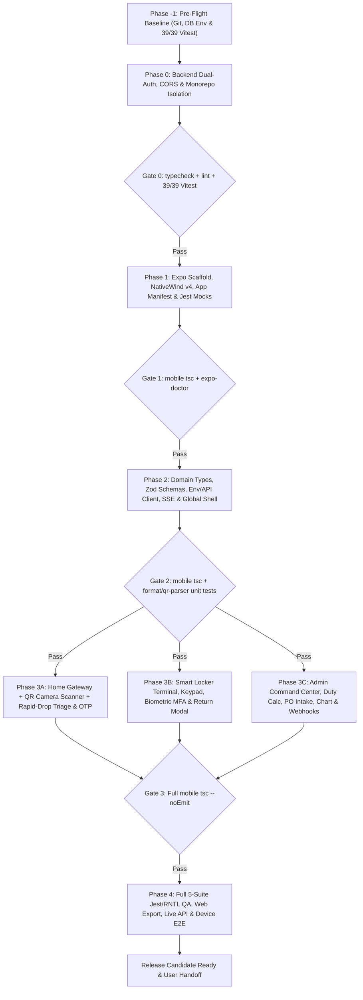

# 📋 Master Execution Plan: KioskDrop Enterprise Mobile App Conversion (React Native / Expo)

> **Companion Specification:** [`MOBILE_APP_CONVERSION_PROMPT.md`](MOBILE_APP_CONVERSION_PROMPT.md)  
> **Operator Handbook:** [`docs/MOBILE_APP_USER_GUIDE.md`](docs/MOBILE_APP_USER_GUIDE.md)  
> **Target Repository:** `d:\PROJECTS\Ricoz Internship\Project 1`  
> **Execution Rule:** Execute strictly in milestone order (`Phase -1 -> Phase 0 -> Phase 1 -> Phase 2 -> Phase 3 -> Phase 4`). Do **not** skip any Gate Verification command or proceed past a failing test/typecheck.

---

## 1. End-to-End Dependency & Milestone Graph

---

## 2. Phase -1: Pre-Flight Environment & Baseline Check

Before modifying a single file, establish a clean baseline on the current workspace (`Windows`, `Node v25.9.0`, `npm 11.6.2`):

| Step | Action | Exact Command (PowerShell at Repo Root) | Expected Result | Status |
| :--- | :--- | :--- | :--- | :--- |
| **-1.1** | Inspect active branch & uncommitted state | `git status -s; git branch --show-current` | Branch identified (`experimental` = SQLite; `main` = PostgreSQL); note any pre-existing user edits so they are never clobbered. | [ ] |
| **-1.2** | Read authoritative backend & UI files | Read `src/lib/session.ts`, `src/app/api/session/role/route.ts`, `src/domain/states.ts`, `src/services/*.ts`, `next.config.js`, `tsconfig.json`, `.gitignore`, `prisma/schema.prisma`, `prisma/seed.ts`. | Full mental model of API shapes, quirks, and CSS tokens. | [ ] |
| **-1.3** | Ensure Prisma client matches active schema & DB is seeded | On `experimental` (SQLite): `$env:DATABASE_URL="file:./dev.db"; npx prisma generate; npx prisma db push` (if `prisma/dev.db` missing, run `npm run db:seed`). | Prisma Client generated without error. | [ ] |
| **-1.4** | Run baseline root quality checks | `$env:DATABASE_URL="file:./dev.db"; npm run typecheck; npm run lint; npm run test` | `0` TS errors, `0` ESLint errors, **39/39** Vitest tests pass. | [ ] |

---

## 3. Phase 0: Backend Mobile-Compatibility & Monorepo Isolation

**Objective:** Enable stateless mobile clients (`Authorization: Bearer <token>`) and Expo Web previews without changing cookie auth, Prisma schema, or any web workflow.

### Task Breakdown
1. **Task 0.1 — Dual-Transport Session Parser (`src/lib/session.ts`)**
   - Import `headers` alongside `cookies` from `"next/headers"`.
   - Inside [`getSession()`](src/lib/session.ts), read `authorization` / `Authorization` header inside a `try/catch`, extract `"Bearer <token>"`, and verify via `verifySession(token)`.
   - Fall back to `cookies().get("kioskdrop_session")?.value` -> `verifySession`, then `DEFAULT_EMPLOYEE_SESSION`.
   - Preserve `UserSession`, `DEFAULT_EMPLOYEE_SESSION`, `UnauthorizedError`, `ForbiddenError`, `signSession()`, `verifySession()`, and `requireRole()` signatures untouched.
2. **Task 0.2 — Expose Token on Role Switch (`src/app/api/session/role/route.ts`)**
   - Return `token` inside the `successResponse({ message, session: sessionData, token })` JSON payload alongside `response.cookies.set("kioskdrop_session", ...)`.
   - Verify `GET /api/session/current` resolves the Bearer token persona automatically.
3. **Task 0.3 — Dev-Friendly API CORS Headers (`next.config.js`)**
   - Keep `output: "standalone"` and `reactStrictMode: true` (`module.exports = nextConfig`).
   - Add `async headers()` on `/api/:path*` allowing `Content-Type, Authorization, idempotency-key, Last-Event-ID, x-servicenow-signature` so Expo Web (`localhost:8081`) communicates seamlessly with Next.js (`localhost:3000`).
4. **Task 0.4 — TypeScript & Git Isolation (`tsconfig.json`, `.gitignore`)**
   - Update `tsconfig.json` -> `"exclude": ["node_modules", "mobile"]`.
   - Append `mobile/node_modules/`, `mobile/.expo/`, `mobile/dist/`, `mobile/web-build/`, `mobile/android/`, `mobile/ios/`, `mobile/.env*`, keystore extensions (`*.jks`, `*.p8`, `*.p12`, `*.key`, `*.mobileprovision`) to `.gitignore`.

### Phase 0 Exit Gate
- [ ] Run `$env:DATABASE_URL="file:./dev.db"; npm run typecheck` -> `0` errors
- [ ] Run `npm run lint` -> `0` errors
- [ ] Run `$env:DATABASE_URL="file:./dev.db"; npm run test` -> **39/39** Vitest tests pass

---

## 4. Phase 1: Expo Project Scaffolding, NativeWind v4 & Test Harness

**Objective:** Initialize `/mobile` with SDK-locked dependencies, custom URL scheme, NativeWind styling pipeline, and deterministic Jest bridge mocks.

### Task Breakdown
1. **Task 1.1 — Scaffold `/mobile` & Install Version-Locked Packages**
   - Run `npx create-expo-app@latest mobile --template blank-typescript` (or `tabs` then prune unused boilerplates cleanly).
   - Inside `mobile/`, install Expo SDK-aligned native packages via `npx expo install`:
     - Navigation & Layout: `expo-router`, `expo-linking`, `expo-constants`, `react-native-safe-area-context`, `react-native-screens`
     - Styling & Icons: `nativewind`, `tailwindcss`, `react-native-reanimated`, `lucide-react-native`, `react-native-svg`
     - Native Hardware & Storage: `expo-camera`, `expo-haptics`, `expo-local-authentication`, `expo-clipboard`, `expo-secure-store`, `@react-native-async-storage/async-storage`
     - Testing DevDeps: `jest-expo`, `@testing-library/react-native`, `@types/jest`
   - Install pure-JS dependencies via `npm install`:
     - `@tanstack/react-query`, `zod`, `zustand`, `react-native-sse`, `react-native-gifted-charts`
2. **Task 1.2 — Configure Manifest & Build Profiles (`app.json`, `eas.json`, `.env.example`, `package.json`)**
   - `app.json`: `"scheme": "kioskdrop"`, `"userInterfaceStyle": "automatic"`, `"experiments": { "typedRoutes": true }`, iOS `NSCameraUsageDescription` + `NSFaceIDUsageDescription`, Android permissions `["CAMERA", "USE_BIOMETRIC", "USE_FINGERPRINT"]`, plugins for `expo-router`, `expo-secure-store`, `expo-camera`, `expo-local-authentication`.
   - `eas.json`: Configure `development`, `preview` (`android.buildType: "apk"`), and `production` profiles.
   - `package.json`: Add scripts `start`, `android`, `ios`, `web`, `typecheck` (`tsc --noEmit`), `test` (`jest --watchAll=false`), `doctor` (`npx expo-doctor`).
   - `.env.example`: Document Android (`10.0.2.2:3000`), iOS (`localhost:3000`), Physical (`LAN IP:3000`), and Production (`https://kioskdrop-enterprise.vercel.app`).
3. **Task 1.3 — Styling & Babel Pipeline (`tsconfig.json`, `tailwind.config.js`, `babel.config.js`, `metro.config.js`, `global.css`)**
   - `mobile/tsconfig.json`: `"strict": true`, `"paths": { "@/*": ["./src/*"] }`.
   - `babel.config.js`: NativeWind JSX import source + `"react-native-reanimated/plugin"` strictly as the **final** plugin.
   - `metro.config.js`: Wrap `getDefaultConfig(__dirname)` with `withNativeWind(config, { input: "./global.css" })`.
   - `tailwind.config.js`: `"darkMode": "class"`, NativeWind preset, Obsidian & Electric Sapphire palette tokens.
4. **Task 1.4 — Jest Runner & Native Bridge Mocks (`jest.config.js`, `jest.setup.ts`)**
   - Configure `preset: "jest-expo"`, `@/*` mapper, and `transformIgnorePatterns` covering `lucide-react-native`, `react-native-gifted-charts`, `nativewind`, and `@expo/*` / `react-native*`.
   - Mock `expo-secure-store` (in-memory Map), AsyncStorage, `expo-haptics`, `expo-local-authentication`, `expo-clipboard`, `expo-camera` (`CameraView`), `react-native-sse`, and `react-native-reanimated`.

### Phase 1 Exit Gate
- [ ] `cd mobile; npx tsc --noEmit` passes (`0` errors)
- [ ] `cd mobile; npx expo-doctor` runs cleanly (resolve any dependency version warnings with `npx expo install --fix` immediately)

---

## 5. Phase 2: Core Infrastructure, Domain Contracts, Telemetry & Shell

**Objective:** Construct the complete typed backbone, real-time SSE lifecycle engine, theme engine, persistent navigation chrome, and global sheets before building feature screens.

### Ordered Implementation Sequence
1. **Leaf Pure Utilities (Zero React / Side-Effect Dependencies)**
   - `src/constants/symptoms.ts` (all 5 backend symptom definitions + icons + SKU preview labels)
   - `src/constants/presets.ts` (API preset URLs, HSN list, BadUSB default vector `0x16C0` / `0x05DF`)
   - `src/lib/theme.ts` (Dark "Obsidian & Electric Sapphire" + Light "Executive Crisp" hex tokens + bay status map)
   - `src/lib/format.ts` (`formatPaiseToINR` with Android Hermes grouping fallback, `formatCompactINR`, `formatCountdown`)
   - `src/lib/qr-parser.ts` (`parseRoomQrPayload`, `sanitizePin`)
   - `src/lib/haptics.ts` (safe wrappers guarding web / unsupported devices)
   - `src/lib/env.ts` (`normalizeApiBaseUrl`, 4-tier `resolveApiBaseUrl` using override -> env -> Expo `hostUri` LAN IP -> `10.0.2.2`/`localhost`)
2. **Types, Schemas, Store & Transport**
   - `src/types/domain.ts` (mirrors Prisma models + `src/domain/states.ts` transition maps)
   - `src/schemas/api.ts` (Zod schemas covering all 20 endpoints, explicitly honoring backend `transaction` key in `POST /api/admin/finops` and `financialSummary` object in `GET /api/admin/analytics`)
   - `src/lib/storage.ts` (`expo-secure-store` token get/set/clear + AsyncStorage helpers)
   - `src/lib/api.ts` (`NetworkConnectionError`, `ApiClientError`, `AbortController` 12s timeout, Bearer header injection, `pingServerLatency`, `generateIdempotencyKey`)
   - `src/store/app-store.ts` (Zustand: `themeMode`, `apiBaseUrlOverride`, `sseConnected`, `telemetryEvents` capped at 50)
3. **Hooks & Global Navigation Shell**
   - `src/hooks/useSession.ts` (`GET /api/session/current` query + `switchRole` mutation storing Bearer token & invalidating caches)
   - `src/hooks/useTelemetrySSE.ts` (`react-native-sse` subscriber for all 8 events + `Last-Event-ID` + `AppState` background close / foreground reconnect with exponential backoff `2s..15s` + query invalidation + `SECURITY_MISMATCH_ALARM` error haptic)
   - `src/components/ui/{ChamferCard,StatusBadge,ScreenHeader}.tsx`
   - `src/components/layout/{GlobalHeader,PersonaServerSheet,TelemetryDrawerModal}.tsx`
   - `app/_layout.tsx` (SafeAreaProvider, QueryClientProvider, SSE bootstrap, NativeWind Dark/Light class wrapper, Stack + `+not-found.tsx`) & `app/(tabs)/_layout.tsx` (4-Tab Bar + persistent `GlobalHeader`)

### Phase 2 Exit Gate
- [ ] Author & run `mobile/__tests__/format.test.ts` (including Golden Duty Vectors A & B parity) and `mobile/__tests__/qr-parser.test.ts`.
- [ ] `cd mobile; npx tsc --noEmit` -> `0` errors
- [ ] `cd mobile; npm test` -> **100%** of Phase 2 tests green

---

## 6. Phase 3: Feature Screens & Native Hardware Modules

**Objective:** Implement all 4 tabs and modals with responsive phone/tablet layouts (`<375pt` 2-col, `375-767pt` 3-col, `>=768pt` 4-col/split), accessibility metadata, and full parity with every backend workflow.

### Sub-Milestone 3A: Home Gateway, QR Camera Scanner & Rapid-Drop Portal
- [ ] `app/(tabs)/index.tsx`: Dynamic hub/bay telemetry rollup, persona status pill, 3 quick-action `ChamferCard`s (`Scan Room QR` -> `/scanner`, `Smart Locker Kiosk` -> `/kiosk`, `ITAM & FinOps Command` -> `/admin`).
- [ ] `app/scanner.tsx`: `expo-camera` `<CameraView />` QR scanning, flashlight toggle, single-scan lock ref, graceful permission-denied / simulator fallback (`Linking.openSettings()` + Manual Room Picker).
- [ ] `src/components/request/{SymptomCard,PinPassCard}.tsx` & `app/(tabs)/request.tsx`:
  - Room selector pills + Floor 3 (`Client-Pitch-3C`) -> Floor 4 Hub proximity fallback hint.
  - 5 symptom cards + `portDamaged` switch on `SYMPTOM_NO_DISPLAY_BYOD` previewing Wireless 4K HDMI Kit.
  - `POST /api/diagnose-and-reserve` with fresh `idempotency-key` per tap.
  - `PinPassCard` with live `MM:SS` -> `EXPIRED` countdown, `expo-clipboard` 1-tap copy, `"******"` idempotency-replay mask guard, and **`Open in Locker Kiosk`** deep link (`locker`, `bay`, `pin`).

### Sub-Milestone 3B: IoT Smart Locker Kiosk & Zero-Trust Return Flows
- [ ] `src/components/kiosk/{LockerBayCard,NumericKeypad,ReturnInspectionModal}.tsx` & `app/(tabs)/kiosk.tsx`:
  - Sync `?locker=` and sanitized `?pin=` from route params.
  - **Enforce `f894343` Safety Fix:** Disable `ENTER`, RFID, and Biometric during `isLoadingLockers === true` and on `/api/lockers` error (`Retry Connection` banner); never emit `"Please enter a valid 6-digit PIN."` when lockers aren't loaded.
  - Responsive 12-bay grid with LED status styling (`STOCKED_AVAILABLE`, `RESERVED_FOR_PICKUP`, `DOOR_OPEN_AWAITING_REMOVAL`, `CHECKED_OUT`, `MAINTENANCE_QUARANTINE`).
  - Backlit keypad (`>= 48pt` targets) + haptic clicks + clearing stale errors on digit/`CLEAR` tap.
  - Corporate RFID tap trigger + `expo-local-authentication` OS prompt sending `"BIO-TMPL"` (`hasHardwareAsync` / `isEnrolledAsync` guard included).
  - Bay actions: `Take Device (IR Break)` (`remove-asset`), `Simulate Foreign BadUSB` (`report-foreign-device` `0x16C0/0x05DF` + error haptic), and `ReturnInspectionModal` supporting all 3 inspection modes (Healthy OEM Return, Faulty 5V Cable `chargingConnected: false`, Counterfeit Swap `409 SECURITY_MISMATCH_ALARM`).
  - Handle both `401 AUTH_FAILED` (guarding non-numeric 5th attempt message) and `423 LOCKER_LOCKED_OUT`.

### Sub-Milestone 3C: ITAM, Landed Cost, FinOps, PO Intake & Telemetry Command Center
- [ ] `src/components/admin/RbacBanner.tsx`: `EMPLOYEE` RBAC guard card with 1-tap `Switch to IT Admin` / `Switch to FinOps`.
- [ ] `src/components/admin/{LandedCostCalculator,AssetRegistrySection}.tsx`:
  - Interactive HSN (`85437099`, `85182210`, `85444299`, `85181000`) & `DIRECT_IMPORT` / `DOMESTIC_WHOLESALE` calculator (`POST /api/admin/compliance/landed-cost`).
  - Asset search + filter pills (`ALL`, `WHITELISTED`, `BLOCKED`, `QUARANTINED`) + `IT_ADMIN` HID whitelist toggle.
- [ ] `src/components/admin/{FinOpsReplenishSheet,ReceptionScanModal}.tsx`:
  - Savings/limit KPIs + PO authorization form (`POST /api/admin/finops` parsing `data.transaction`!).
  - **`PENDING_RECEPTION` PO Intake Flow:** **`Scan & Stock Received Hardware`** button on pending POs invoking `POST /api/admin/reception/scan` with SKU, scannable/editable Serial, VID/PID, Locker & Bay `1–12`.
- [ ] `src/components/admin/ProcurementBarChart.tsx`:
  - Analytics reading `financialSummary`, 14-day room anomaly alerts (`Boardroom-4B`), floor occupancy progress cards, and `react-native-gifted-charts` `<BarChart />` comparing `Wholesale B2B`, `Retail Avoided`, and `Net Savings` across months.
- [ ] `src/components/admin/WebhookInspectorModal.tsx`:
  - ServiceNow / Zendesk test event buttons (`POST /api/webhooks/servicenow`, `POST /api/webhooks/zendesk`) + payload inspector modal + Replay CTA (`POST /api/admin/webhooks`).
- [ ] `app/(tabs)/admin.tsx`: Segmented 4-module controller wiring all components cleanly with React Query invalidations.

### Phase 3 Exit Gate
- [ ] `cd mobile; npx tsc --noEmit` -> `0` errors across all routes and components

---

## 7. Phase 4: Component QA, Live Integration Verification & Documentation

### Task Breakdown
1. **Task 4.1 — Complete All 5 Jest + RNTL Test Suites (`mobile/__tests__/`)**
   - [ ] `format.test.ts` (INR formatting, Hermes Indian comma fallback, golden vectors A & B, env URL resolver, countdown timer)
   - [ ] `qr-parser.test.ts` (`kioskdrop://`, `https://`, JSON payload, case-insensitive slug, malicious URL rejection, `sanitizePin`)
   - [ ] `keypad-kiosk.test.tsx` (loading/error separation vs PIN validation, digit/CLEAR error reset, 6-digit PIN submit, `401` vs `423`, RFID/Biometric trigger guards)
   - [ ] `request-triage.test.tsx` (Floor 3 fallback hint, `portDamaged` switch, `PinPassCard` render, copy PIN, `"******"` mask guard)
   - [ ] `admin-rbac.test.tsx` (`EMPLOYEE` banner + disabled toggles, role switch token persistence, Landed Cost display)
2. **Task 4.2 — Bundle & Static Health Checks**
   - [ ] `cd mobile; npm test` -> **5/5** suites, all tests passing
   - [ ] `cd mobile; npx tsc --noEmit` -> `0` errors
   - [ ] `cd mobile; npx expo-doctor` -> clean pass
   - [ ] `cd mobile; npx expo export --platform web` (or Metro export smoke check) -> zero missing asset/import errors
   - [ ] Root regression check: `$env:DATABASE_URL="file:./dev.db"; npm run typecheck; npm run lint; npm run test` -> **39/39** Vitest still green!
3. **Task 4.3 — Live Dual-Process Runtime Verification**
   - Start Next.js backend locally (`$env:DATABASE_URL="file:./dev.db"; npm run dev`).
   - Run automated HTTP/SSE Bearer verification script against `http://localhost:3000`:
     - Verify `GET /api/admin/compliance` unauthenticated -> `403`.
     - Verify `POST /api/session/role` (`{"role":"IT_ADMIN"}`) returns signed `token`.
     - Verify `GET /api/admin/compliance` with `Authorization: Bearer <token>` -> `200`.
     - Verify full mobile API loop: `POST /api/diagnose-and-reserve` -> `POST /api/kiosk/authenticate-and-unlock` (`BIOMETRIC` / `"BIO-TMPL"` or PIN) -> `POST /api/kiosk/remove-asset` -> `POST /api/kiosk/return-asset` -> `POST /api/admin/finops` -> `POST /api/admin/reception/scan`.
   - Test Android Emulator (`10.0.2.2:3000`) / Expo Web (`localhost:8081`) / connected ADB device if running; inspect UI viewports (`360x800` phone + tablet), Dark/Light toggle, zero console crashes, and deep links (`npx uri-scheme open "kioskdrop://request?room=Boardroom-4B" --android`). Note truthfully if iOS Simulator is unavailable on Windows host.
4. **Task 4.4 — Author Developer Runbook (`mobile/README.md`)**
   - Document scripts, emulator vs physical LAN setup, deep-link commands, and EAS build commands.

---

## 8. Risk Register & Windows-Specific Pitfalls

| Risk / Pitfall | Impact | Exact Preventive Fix |
| :--- | :--- | :--- |
| `.env` points to Neon Postgres while `experimental` uses SQLite | `prisma` commands or Vitest fail on schema mismatch | Prefix root commands on `experimental` with `$env:DATABASE_URL="file:./dev.db"` and never overwrite `.env` or modify `prisma/schema.prisma` provider. |
| Root `tsconfig.json` compiles `mobile/` TS/JSX | `npm run typecheck` fails with React Native type conflicts | Exclude `"mobile"` in root `tsconfig.json` during **Phase 0**. |
| `babel-preset-expo` + Reanimated plugin ordering | App crashes on launch with Reanimated worklet error | Place `"react-native-reanimated/plugin"` as the **last** item in `mobile/babel.config.js` `plugins`. |
| Hermes lacks browser `EventSource` | Runtime `ReferenceError: Can't find variable: EventSource` | Exclusively import `EventSource` from `react-native-sse`. |
| Physical phone on Wi-Fi hits `localhost` instead of host PC | Network unreachable in Expo Go | `env.ts` auto-extracts Expo `hostUri` IP (`http://<LAN-IP>:3000`); allow Windows Firewall inbound TCP `3000` if needed; use `PersonaServerSheet` **Test Ping**. |
| `node v25.9.0` with Expo / Metro packages | Occasional engine warnings or native-module drift | Always install Expo packages via `npx expo install` and verify with `npx expo-doctor`. |

---

## 9. Final Sign-Off Checklist (Definition of Done)

- [ ] Phase 0 root changes verified (`git diff src/ next.config.js tsconfig.json .gitignore`) with zero unrelated edits
- [ ] Root `npm run typecheck`, `npm run lint`, and `npm run test` (**39/39** Vitest) passing
- [ ] Mobile `npx tsc --noEmit`, `npm test` (all **5** Jest suites), `npx expo-doctor`, and Expo bundle export passing
- [ ] Live Bearer Auth, RBAC, Diagnostic Reserve, Kiosk PIN/Biometric/BadUSB/Return, Customs Duty, PO Restock + Reception Scan, Analytics Chart, and Webhooks verified against running server
- [ ] `mobile/README.md` completed and `docs/MOBILE_APP_USER_GUIDE.md` verified accurate
- [ ] No commits or pushes performed without explicit user authorization

