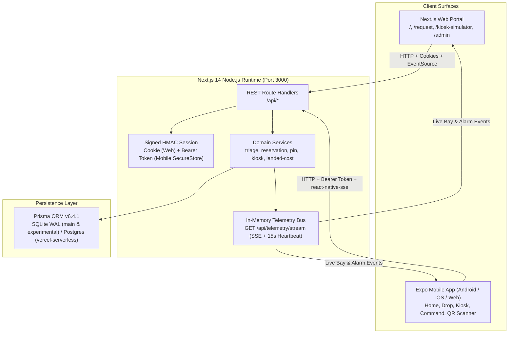

# ⚡ KioskDrop Enterprise — Complete Project & Setup Guide

> **One-stop master manual** for understanding, configuring, running, testing, and building the entire **KioskDrop Enterprise** platform: the **Next.js 14 Web Portal & REST/SSE API Backend**, **Prisma ORM Database**, and the **React Native / Expo Mobile App (`/mobile`)** for Android, iOS, and Web.

---

## Table of Contents

1. [Project Overview & Core Capabilities](#1-project-overview--core-capabilities)
2. [System Architecture](#2-system-architecture)
3. [Branches & Repository Structure](#3-branches--repository-structure)
4. [Prerequisites](#4-prerequisites)
5. [Environment Configuration](#5-environment-configuration)
6. [Complete Setup & Launch Guide (Step-by-Step)](#6-complete-setup--launch-guide-step-by-step)
   - [Step 1 — Clone & Install Dependencies](#step-1--clone--install-dependencies)
   - [Step 2 — Initialize & Seed the Database](#step-2--initialize--seed-the-database)
   - [Step 3 — Start the Next.js Web & API Backend (Terminal 1)](#step-3--start-the-nextjs-web--api-backend-terminal-1)
   - [Step 4A — Run Mobile App on Android Emulator (Windows)](#step-4a--run-mobile-app-on-android-emulator-windows)
   - [Step 4B — Run Mobile App on Physical Android / iPhone (Expo Go)](#step-4b--run-mobile-app-on-physical-android--iphone-expo-go)
   - [Step 4C — Run Web UI & Expo Web in Desktop Browser](#step-4c--run-web-ui--expo-web-in-desktop-browser)
7. [Seeded Personas, Meeting Rooms, Hubs & Deep Links](#7-seeded-personas-meeting-rooms-hubs--deep-links)
8. [End-to-End Walkthrough (Manual Testing Scenarios)](#8-end-to-end-walkthrough-manual-testing-scenarios)
9. [API & Real-Time Telemetry Reference](#9-api--real-time-telemetry-reference)
10. [Quality Gates, Automated Tests & Builds](#10-quality-gates-automated-tests--builds)
11. [Deployment & Standalone APK Builds](#11-deployment--standalone-apk-builds)
12. [Troubleshooting & Daily Commands](#12-troubleshooting--daily-commands)
13. [Additional Documentation](#13-additional-documentation)

---

## 1. Project Overview & Core Capabilities

**KioskDrop Enterprise** solves corporate conference room Audio/Visual ("last-meter") connectivity failures in under 60 seconds using QR-driven room triage, distributed IoT smart lockers, zero-trust hardware whitelisting, and corporate FinOps procurement.

| Domain Module | What It Does | Key Engineering Highlights |
| :--- | :--- | :--- |
| **Rapid-Drop AV Triage** | Employees scan a meeting room QR code (or choose a room), pick a failure symptom, toggle **broken laptop USB-C port** bypass if needed, and receive a hardware pass with a 6-digit OTP and 10-minute reservation countdown. | Deterministic triage matrix (`src/services/triage.ts`), floor-proximity hub routing (`Floor 3 -> Floor 4`), atomic bay locking (`updateMany` + `count === 1`), idempotency keys. |
| **IoT Smart Locker Kiosk** | Simulates multi-bay physical locker hubs (`12` bays per floor) with 6-digit PIN keypad, `13.56MHz` RFID badge tap, OS Face ID / Fingerprint unlock, IR break-beam pickup, and 5V/3A return inspection. | Timing-safe HMAC-SHA256 PIN verification (`crypto.timingSafeEqual`), 5-attempt brute-force lockout (`HTTP 423`), BadUSB foreign VID/PID quarantine (`HTTP 409`). |
| **Zero-Trust Compliance & Customs Duty Engine** | Manages USB HID Vendor/Product ID whitelists (`WPC ETA`, `BIS CRS`) and computes Indian Customs landed cost (**Landing Charges 1% + BCD 20% + SWS 10% of BCD + IGST 18%** = `44.40%` statutory duty). | Strictly uses **integer paise** arithmetic (`1 INR = 100 paise`) with component-level round-half-up to avoid IEEE 754 float drift (`src/services/landed-cost.ts`). |
| **FinOps POs & Reception Intake** | Reconciles Zaggle & Happay prepaid card spends under MCC `5045`, syncs ERP targets (`SAP_S4HANA`, `ORACLE_NETSUITE`, `ZOHO_BOOKS`), generates CGST Rule 46 invoice numbers, and stocks hardware into locker bays via mobile scan intake. | Role-based access control (`IT_ADMIN` writes, `FINOPS_AUDITOR` read-only audit, `EMPLOYEE` blocked with `403`). |
| **Shrinkage Analytics & ITSM Webhooks** | Flags meeting rooms exceeding `>= 4` unreturned checkouts within a rolling 14-day window (pre-seeded anomaly in `Boardroom-4B`), displays 5-month wholesale vs retail savings, and logs/replays ServiceNow & Zendesk webhooks. | Tamper-evident SHA-256 custody hash chain (`CustodyLog`) + persistent SSE stream (`/api/telemetry/stream`) using `react-native-sse` on mobile. |

> **Simulation Posture (ADR D1):** Business logic, database transactions, state machines, cryptography, duty math, concurrency retries, and SSE streaming are all real and tested. External systems (ServiceNow, Zendesk, Zaggle, Happay, SAP/Oracle/Zoho, WPC/BIS lookups, physical locker solenoids/sensors) run behind clean adapter boundaries and realistic simulators.

---

## 2. System Architecture



### How Web & Mobile Share One Backend

- **Web (`src/app/`)** authenticates via HTTP-only `kioskdrop_session` cookie set by `POST /api/session/role`.
- **Mobile (`/mobile`)** stores the signed token returned by `POST /api/session/role` inside `expo-secure-store` (or `AsyncStorage` on Expo Web) and sends `Authorization: Bearer <token>` on every `fetch` and `react-native-sse` request.
- `src/lib/session.ts` checks **Bearer token first**, then falls back to the **cookie**, so both clients talk to the exact same API endpoints and database seamlessly.
- **CORS (`next.config.js`)** enables cross-origin requests on `/api/:path*` so Expo Web (`http://localhost:8081`) and mobile apps can access the Next.js API (`:3000`).

---

## 3. Branches & Repository Structure

### Active Branches

| Branch | Database Provider | Purpose |
| :--- | :--- | :--- |
| **`main`** | **SQLite WAL** (`file:./dev.db`) | Primary full-stack release branch containing the Next.js web/API backend **and** the complete Expo SDK 58 mobile app (`/mobile`). |
| **`experimental`** | **SQLite WAL** (`file:./dev.db`) | Active development branch synced with `main` (Next.js web/API backend + Expo SDK 58 mobile app). |
| **`docker`** | SQLite WAL (`/app/prisma/dev.db`) | Containerized Docker / Docker Compose deployment branch. |
| **`vercel-serverless`** | Cloud Postgres (Neon) | Serverless Vercel web deployment branch. |

Remote repository for this workspace: `https://github.com/AgrShubham/kioskdrop-mobile.git` (`origin`).

### Directory Layout

```text
KioskDrop App/
├── prisma/
│   ├── schema.prisma               # Prisma schema (13 models; SQLite provider on main/experimental)
│   ├── seed.ts                     # Resets & seeds 3 personas, 4 rooms, 7 SKUs, 24 bays, anomaly history, POs, webhooks
│   ├── dev.db (+ -wal, -shm)       # Local SQLite database (gitignored)
│   └── migrations/                 # SQL migration history
├── src/
│   ├── app/
│   │   ├── page.tsx                # Web landing page
│   │   ├── request/page.tsx        # Web Rapid-Drop employee portal
│   │   ├── kiosk-simulator/page.tsx# Web 12-bay smart locker simulator
│   │   ├── admin/page.tsx          # Web ITAM, Duty, FinOps, Analytics & Webhooks command center
│   │   └── api/                    # 19 REST + SSE Route Handlers
│   ├── domain/states.ts            # Pure finite-state machines (CompartmentStatus, TicketStatus)
│   ├── lib/                        # prisma.ts, session.ts, telemetry-bus.ts, locker-lockout.ts, api-response.ts
│   └── services/                   # triage.ts, reservation.ts, kiosk.ts, pin.ts, landed-cost.ts
├── test/                           # 7 Vitest test files (39 backend/unit/concurrency tests)
├── mobile/                         # Expo SDK 58 / React Native 0.88 mobile workspace
│   ├── app/
│   │   ├── _layout.tsx             # Root QueryClient + Theme + StatusBar/NavigationBar/SystemUI + SSE mount
│   │   ├── scanner.tsx             # Native camera QR scanner + manual room fallback modal
│   │   ├── +not-found.tsx          # Deep-link unmatched route fallback
│   │   └── (tabs)/
│   │       ├── _layout.tsx         # 4-tab bar + GlobalHeader + PersonaServerSheet + TelemetryDrawerModal
│   │       ├── index.tsx           # Home Gateway (live fleet KPIs, quick actions, active role)
│   │       ├── request.tsx         # Drop Tab (room picker, Floor fallback banner, 5 symptoms, OTP pass)
│   │       ├── kiosk.tsx           # Kiosk Tab (hub switcher, 12-bay grid, PIN pad, RFID, Biometric, BadUSB/return modals)
│   │       └── admin.tsx           # Command Tab (4 modules: Zero-Trust & Duty, FinOps & POs, Analytics & Hubs, Webhooks)
│   ├── src/
│   │   ├── components/             # UI cards, keypad, inspection modal, reception modal, SVG chart, sheets
│   │   ├── constants/              # symptoms.ts, presets.ts (API URLs, HSN presets, BadUSB test vector)
│   │   ├── hooks/                  # useSession.ts (Bearer + Query cache), useTelemetrySSE.ts
│   │   ├── lib/                    # api.ts, env.ts (4-tier URL resolver), format.ts, qr-parser.ts, storage.ts, theme.ts
│   │   ├── schemas/api.ts          # Zod runtime validators for all API responses
│   │   ├── store/app-store.ts      # Zustand store (theme, server URL override, SSE state)
│   │   └── types/domain.ts         # Shared mobile TypeScript contracts
│   ├── __tests__/                  # 5 Jest + RNTL test suites (24 mobile tests)
│   ├── app.json                    # Expo config, permissions, scheme: "kioskdrop://"
│   ├── eas.json                    # EAS Cloud Build profiles (development, preview APK, production)
│   └── package.json                # Mobile scripts & dependencies
├── docs/                           # DECISIONS.md, DEPLOYMENT_GUIDE.md, BUSINESS_DECK.md, MOBILE_APP_USER_GUIDE.md
├── .env.example                    # Safe environment variable template
├── Dockerfile & docker-compose.yml # Containerized deployment setup
├── next.config.js                  # Standalone output + /api/* CORS headers
├── vitest.config.ts                # Single-thread Vitest runner locked to local SQLite
└── PROJECT_GUIDE.md                # This master guide
```

---

## 4. Prerequisites

| Tool | Required For | Version / Notes |
| :--- | :--- | :--- |
| **Node.js & npm** | Everything (Web, API, Prisma, Mobile) | Node.js `>= 18.18.0` (tested on `v20.x` & `v25.x`), npm `>= 9.0.0` |
| **Git** | Cloning & branch switching | Standard Git CLI |
| **Android Studio + SDK + AVD** | Android Emulator on laptop | Create an AVD such as `Pixel_8_API_34` (API 34+); install **Android SDK Platform-Tools** (`adb`) |
| **Expo Go (Mobile Store)** | Running on physical Android or iPhone | Install from Google Play Store or Apple App Store (zero native build required) |
| **macOS + Xcode** *(optional)* | Local iOS Simulator | macOS only; on Windows use Expo Go on a real iPhone or EAS Build |
| **Docker Desktop** *(optional)* | Running via `docker compose` | Required only for container deployment |

Verify your toolchain in a terminal:

```cmd
node -v
npm -v
adb version
```

---

## 5. Environment Configuration

### Root Backend Environment (`.env`)

Copy `.env.example` to `.env` in the repository root:

- **Windows `cmd.exe`:**
  ```cmd
  copy .env.example .env
  ```
- **PowerShell:**
  ```powershell
  Copy-Item .env.example .env
  ```
- **macOS / Linux:**
  ```bash
  cp .env.example .env
  ```

Variables defined in `.env.example`:

| Variable | Example / Default | Purpose |
| :--- | :--- | :--- |
| `DATABASE_URL` | `"file:./dev.db"` | Database connection string (`experimental` uses SQLite `file:./dev.db`, stored at `prisma/dev.db`) |
| `NODE_ENV` | `"development"` | Runtime mode (`development` or `production`) |
| `DEMO_MODE` | `"true"` | Enables demo persona role switching |
| `SERVER_PIN_PEPPER` | `"kioskdrop-secret-pepper-2026-production-entropy"` | HMAC-SHA256 pepper for hashing 6-digit locker OTPs (`src/services/pin.ts`) |
| `SESSION_SECRET` | `"kioskdrop-session-secret-key-32charsmin-abc123"` | HMAC-SHA256 secret signing web cookies and mobile Bearer tokens (`src/lib/session.ts`) |
| `WEBHOOK_SIGNING_SECRET` | `"kioskdrop-webhook-hmac-sha256-signing-secret"` | Signing secret for webhook audit flows |
| `RESERVATION_TTL_MINUTES` | `"10"` | Pickup reservation expiry window in minutes |
| `RETURN_DUE_HOURS` | `"4"` | Expected equipment return window in hours |

> **CRITICAL SQLite vs PostgreSQL Rule (`main` / `experimental` branches):**
> On `main` and `experimental`, `prisma/schema.prisma` sets `provider = "sqlite"`. If your local `.env` contains a `postgresql://...` connection string left over from another branch (like `vercel-serverless`), Prisma CLI and Next.js will fail unless you either:
> 1. Set `DATABASE_URL="file:./dev.db"` inside `.env`, **OR**
> 2. Override `DATABASE_URL` in your terminal session before running `prisma` and `next dev` (shown in the commands below).
> Never commit real `.env` secrets to Git (`.env` is already gitignored).

### Mobile Environment (`mobile/.env`, optional)

The mobile app works out of the box **without** creating `mobile/.env` because `mobile/src/lib/env.ts` resolves the API base URL in 4 automatic tiers:

1. **In-app override** saved in Zustand (**Header Persona Chip `EMP`/`IT`/`FIN` -> Next.js API Server Target**).
2. **`EXPO_PUBLIC_API_URL`** environment variable (if set in `mobile/.env` — see `mobile/.env.example`).
3. **Automatic LAN IP extraction** from Expo Go (`Constants.expoConfig.hostUri` -> `http://<PC-LAN-IP>:3000`).
4. **Platform fallback**: `http://10.0.2.2:3000` on Android, `http://localhost:3000` on iOS/Web.

---

## 6. Complete Setup & Launch Guide (Step-by-Step)

> **Check which terminal shell you are using!**
> In VS Code / Antigravity on Windows, the bottom-right terminal list tells you whether a tab is **`cmd`** (Command Prompt) or **`pwsh` / `powershell`** (PowerShell).
> - Never type PowerShell `$env:...` syntax inside `cmd.exe`.
> - Never type `cmd.exe` `set VAR=...` syntax inside PowerShell.
> Exact commands for **all 3 shells** are provided below.

### Step 1 — Clone & Install Dependencies

Only needed once (skip `git clone` if the repo is already on your machine):

```cmd
git clone https://github.com/AgrShubham/kioskdrop-mobile.git
cd kioskdrop-mobile
git checkout main   # or: git checkout experimental
```

Install dependencies for **both** the root Next.js backend/web project and the `/mobile` Expo workspace:

```cmd
npm install
cd mobile
npm install
cd ..
```

### Step 2 — Initialize & Seed the Database

Run Prisma generation, push the schema to SQLite (`prisma/dev.db`), and seed the sample enterprise dataset from the **repository root**:

**Windows Command Prompt (`cmd`):**
```cmd
set DATABASE_URL=file:./dev.db
npx prisma generate
npx prisma db push
npm run db:seed
```

**Windows PowerShell (`pwsh`):**
```powershell
$env:DATABASE_URL="file:./dev.db"
npx prisma generate
npx prisma db push
npm run db:seed
```

**macOS / Linux (`bash` / `zsh`):**
```bash
export DATABASE_URL="file:./dev.db"
npx prisma generate
npx prisma db push
npm run db:seed
```

Expected seed output:
- `3` corporate personas
- `4` meeting rooms
- `4` tariff HSN rates & `7` hardware SKUs
- `2` smart lockers (`24` compartments total) + `2` anomaly/test fixtures
- Historical 14-day checkout records (`Boardroom-4B` flagged as an anomaly)
- Seeded Purchase Order (`PO-2026-001`), Zaggle/Happay FinOps transactions, Genesis SHA-256 `CustodyLog`, and `2` Webhook events.

---

### Step 3 — Start the Next.js Web & API Backend (Terminal 1)

Leave **Terminal 1** open at the repository root. We bind Next.js to `0.0.0.0` (`-H 0.0.0.0`) instead of `127.0.0.1` so both your **Android Emulator** (`10.0.2.2:3000`) and **physical phones on Wi-Fi** (`<PC-LAN-IP>:3000`) can reach the API:

**Windows Command Prompt (`cmd`):**
```cmd
set DATABASE_URL=file:./dev.db
npx next dev -H 0.0.0.0 -p 3000
```

**Windows PowerShell (`pwsh`):**
```powershell
$env:DATABASE_URL="file:./dev.db"
npx next dev -H 0.0.0.0 -p 3000
```

**macOS / Linux (`bash` / `zsh`):**
```bash
DATABASE_URL="file:./dev.db" npx next dev -H 0.0.0.0 -p 3000
```

Wait until you see Next.js report listening on port `3000` (`Ready in ...`).

---

### Step 4A — Run Mobile App on Android Emulator (Windows)

Follow this order carefully so the emulator window opens **visibly on your desktop**:

1. **Check available Android Virtual Devices (AVDs):**
   ```cmd
   "%LOCALAPPDATA%\Android\Sdk\emulator\emulator.exe" -list-avds
   ```
   *(On this workstation, `Pixel_8_API_34` and `Pixel_Fold_API_34` are available; or open **Android Studio -> Virtual Device Manager** and click Play.)*

2. **Launch the Android Emulator visibly** (use `start ""` in `cmd` so it detaches as a normal GUI window on your taskbar!):

   **Windows Command Prompt (`cmd`):**
   ```cmd
   start "" "%LOCALAPPDATA%\Android\Sdk\emulator\emulator.exe" -avd Pixel_8_API_34
   ```

   **Windows PowerShell (`pwsh`):**
   ```powershell
   Start-Process "$env:LOCALAPPDATA\Android\Sdk\emulator\emulator.exe" -ArgumentList "-avd","Pixel_8_API_34"
   ```

   Wait until the Android home screen finishes booting and verify ADB detects it as `device` (not `offline`):
   ```cmd
   adb devices
   ```

3. **Open a second terminal (Terminal 2) in `mobile/` and launch KioskDrop:**

   ```cmd
   cd mobile
   npm run android
   ```

   **OR** use interactive Expo Metro:
   ```cmd
   cd mobile
   npm start
   ```
   Then wait for the Metro QR/menu prompt (`› Press a │ open Android`) and press **`a`** **inside that running Metro terminal** (never type `a` at an ordinary `cmd>` prompt).

4. **Verify live API & SSE inside the app:**
   - Top-right header should show green **`LIVE`** badge (SSE connected to `http://10.0.2.2:3000/api/telemetry/stream`).
   - Home tab should show **`24 TOTAL BAYS`** and **`24 AVAILABLE`** after a fresh seed.

---

### Step 4B — Run Mobile App on Physical Android / iPhone (Expo Go)

This lets you test on a real iPhone or Android device on the same Wi-Fi without needing Xcode or Android Studio:

1. Install **Expo Go** from Google Play Store (Android) or Apple App Store (iOS).
2. Ensure **Terminal 1** is running `npx next dev -H 0.0.0.0 -p 3000` (binding `0.0.0.0` is mandatory!).
3. **Allow inbound TCP port `3000` through Windows Firewall** (run **PowerShell as Administrator** once):
   ```powershell
   New-NetFirewallRule -DisplayName "KioskDrop Nextjs Dev 3000" -Direction Inbound -Protocol TCP -LocalPort 3000 -Action Allow
   ```
4. In **Terminal 2**:
   ```cmd
   cd mobile
   npm start
   ```
5. Scan the terminal QR code using **Expo Go** (Android) or the **iOS Camera app** (iPhone).
6. Expo automatically detects your PC's Wi-Fi IP (`http://<YOUR-PC-LAN-IP>:3000`). Confirm inside the app via **Top-Right Persona Chip (`EMP`/`IT`/`FIN`) -> Test Ping**.

> **Finding your Windows Wi-Fi IP manually (PowerShell):**
> ```powershell
> Get-NetIPAddress -AddressFamily IPv4 | Where-Object { $_.InterfaceAlias -notlike "*Loopback*" -and $_.IPAddress -notlike "169.254*" } | Select-Object InterfaceAlias, IPAddress
> ```

---

### Step 4C — Run Web UI & Expo Web in Desktop Browser

With **Terminal 1** running on port `3000`, you can preview **two** web experiences:

1. **Full Next.js Enterprise Web App:**
   - Overview Portal: `http://localhost:3000/`
   - Employee Rapid-Drop Portal: `http://localhost:3000/request?room=Boardroom-4B&floor=4`
   - 12-Bay Locker Kiosk Simulator: `http://localhost:3000/kiosk-simulator`
   - ITAM / Duty / FinOps Command Center: `http://localhost:3000/admin`
2. **Expo Mobile App in Desktop Browser (Expo Web):**
   ```cmd
   cd mobile
   npm run web
   ```
   Opens at `http://localhost:8081` and communicates with `http://localhost:3000/api/*` via CORS.

---

## 7. Seeded Personas, Meeting Rooms, Hubs & Deep Links

### Pre-Seeded Corporate Personas

Switch personas anytime in the **Web Navbar dropdown** or **Mobile Header Chip (`EMP` / `IT` / `FIN`)**:

| Persona | Role | User ID | RFID Badge | Permissions |
| :--- | :--- | :--- | :--- | :--- |
| **Aarav Sharma** | `EMPLOYEE` *(default)* | `usr_emp_01` | `RFID-EMP-8821` | Can access Home, Drop (`/request`), and Kiosk unlock. Blocked (`403`) on Admin Command modules. |
| **Priya Patel** | `IT_ADMIN` | `usr_it_02` | `RFID-IT-0042` | Full read/write access across Zero-Trust Whitelist, PO Replenishment, PO Reception Scan, Analytics, & Webhooks. |
| **Vikram Malhotra** | `FINOPS_AUDITOR` | `usr_fin_03` | `RFID-FIN-1109` | Read-only audit access to Compliance, FinOps Ledger, & Analytics; writes blocked (`403`); Webhooks restricted to `IT_ADMIN`. |

### Seeded Meeting Rooms (`MeetingRoom`)

| Room Name | `qrCodeSlug` | Floor | Display / System | Notes |
| :--- | :--- | :--- | :--- | :--- |
| **Executive Boardroom 4B** | `Boardroom-4B` | 4 | `4K_LED_WALL` / `BYOD_LEGACY` | Seeded with `4` unreturned checkouts within 10 days -> triggers **14-Day Shrinkage Anomaly** (`HIGH_ANOMALY_FLAGGED`). |
| **Innovation Lab 4A** | `Innovation-Lab-4A` | 4 | `DUAL_MONITOR` / `TEAMS_ROOM` | Served locally by Floor 4 Hub. |
| **Townhall Auditorium 2A** | `Townhall-2A` | 2 | `PROJECTOR_HDMI` / `ZOOM_ROOM` | Seeded with `3` unreturned checkouts (`< 4` threshold -> NOT flagged). |
| **Client Pitch Room 3C** | `Client-Pitch-3C` | 3 | `4K_LED_WALL` / `BYOD_LEGACY` | **No Floor 3 locker** -> tests proximity fallback (`Floor 3 -> Floor 4 Boardroom Hub`). Checkouts are 17–26 days old (`> 14` days -> NOT flagged). |

### Seeded Smart Locker Hubs (`SmartLocker`)

- **`lkr_floor4` — `Floor 4 Boardroom Hub`** (`12` bays):
  - Bays `1–3`: USB-C 60W PD Hubs (`SN-USBC-401..403`, VID `0x291A`, PID `0xA102`)
  - Bays `4–5`: Barco 4K Wireless HDMI Kits (`SN-WHDMI-401..402`, VID `0x0600`, PID `0x0040`)
  - Bay `6`: Kramer HDCP 2.2 4K Scaler (`SN-HDCP-401`, VID `0x0BDA`, PID `0x5411`)
  - Bays `7–8`: Belkin HDMI 2.1 Cables (`SN-HDMI-401..402`, VID `0x0000`, PID `0x0000`)
  - Bay `9`: Club3D DisplayPort 1.4 Cable (`SN-DP-401`, VID `0x0000`, PID `0x0000`)
  - Bays `10–11`: Logitech Spotlight BLE Remotes (`SN-SPOT-401..402`, VID `0x046D`, PID `0xC53E`)
  - Bay `12`: Shure Boundary Mic Kit (`SN-MIC-401`, VID `0x14ED`, PID `0x1012`)
- **`lkr_floor2` — `Floor 2 Townhall Hub`** (`12` bays, mixed across all 7 SKUs).
- **Pre-seeded Quarantined Fixtures** (visible in Asset Registry): `SN-USBC-DEFECTIVE-99` (`NEEDS_INSPECTION`) and `SN-BADUSB-RUBBER-DUCKY-01` (`hidWhitelisted: false`, `0x16C0/0x05DF`).

### Deep-Link URI Testing (Mobile + `adb`)

With an Android Emulator or USB phone connected (`cd mobile`):

```cmd
npx uri-scheme open "kioskdrop://request?room=Boardroom-4B&floor=4" --android
npx uri-scheme open "kioskdrop://kiosk?locker=lkr_floor4&bay=1&pin=123456" --android
```

Accepted QR payloads (`mobile/src/lib/qr-parser.ts`) include `kioskdrop://request?room=...`, trusted web URLs (`/request?room=...`), JSON (`{"room":"Innovation-Lab-4A"}`), or raw slugs (`Townhall-2A`).

---

## 8. End-to-End Walkthrough (Manual Testing Scenarios)

Follow these 4 flows after a fresh seed to exercise the entire system end-to-end:

### Flow 1 — Rapid-Drop Floor Fallback & Broken Port Bypass (**Drop Tab**)
1. Open **Drop** (`/(tabs)/request` or web `/request`).
2. Tap **Scan Room QR** to verify the camera permission / manual fallback room picker (`FALLBACK_ROOMS`), or select **`Client-Pitch-3C`** directly.
3. Confirm the sapphire routing pill shows **`Nearest Hub Routing: Floor 3 -> Floor 4 Boardroom Hub`**.
4. Select **"No Display on Laptop (USB-C / HDMI)"**.
5. Toggle **`Laptop USB-C port physically loose/damaged`** ON -> watch the preview switch from *Anker USB-C 60W PD Display Hub* to **`Barco CS-400W 4K Wireless HDMI Kit`**.
6. Tap **`Diagnose & Reserve Hardware`** -> note the ServiceNow incident (`INC00...`), Floor 4 Bay `#4` (or `#5`), **6-digit PIN**, and **10:00 countdown**, then tap **`Open in Locker Kiosk`**.

### Flow 2 — Smart Locker Solenoid Unlock & BadUSB Return Alarm (**Kiosk Tab**)
1. Verify the Kiosk loads **`Floor 4 Boardroom Hub`** with your reserved bay highlighted in Amber (`RESERVED`) and the 6-digit PIN pre-filled.
2. Unlock via **Keypad (`ENTER`)**, **Tap RFID Badge**, or **Biometric Unlock (Face / Touch)** (on devices with enrolled biometrics).
3. Bay transitions to **`DOOR OPEN`** (Sky Blue). Tap **`Take Device (IR Break)`** -> bay transitions to **`CHECKED OUT`**.
4. Tap **`Return & Plug In`** on that checked-out bay to open the sensor inspection sheet:
   - **Healthy OEM Return:** Keep defaults -> submits `chargingConnected: true` -> bay returns to `STOCKED_AVAILABLE` (Emerald) and closes the ticket.
   - **Defective 5V/3A Fault:** Tap **`Defective 5V/3A Fault`** preset -> closes the employee's ticket cleanly while placing the bay into **`QUARANTINE`** for IT inspection.
   - **Counterfeit / BadUSB Swap:** Tap **`Counterfeit / BadUSB Swap`** preset (`0x16C0 / 0x05DF`) -> triggers **`HTTP 409` Security Alarm**, locks the bay into **`QUARANTINE`** (Crimson), fires error haptics, and broadcasts **`SECURITY_MISMATCH_ALARM`** into the top-right **`LIVE` Telemetry Drawer**.
5. *(Optional Brute-Force Test)*: Entering 5 consecutive invalid 6-digit PINs locks that hub with **`HTTP 423`** for 15 minutes (cleared by restarting the Node server).

### Flow 3 — RBAC Escalation, Customs Duty Vectors & Mobile PO Intake (**Command Tab**)
1. Switch to **Command** (`/(tabs)/admin`) as **Aarav (`EMPLOYEE`)** -> verify the **`403 RBAC ENFORCED`** banner blocks Compliance/FinOps/Analytics/Webhooks while leaving the interactive Duty Calculator usable.
2. Tap **`Switch to IT Admin (Priya Patel)`** inside the banner -> app stores the signed Bearer token and immediately unlocks all 4 modules.
3. **Zero-Trust & Duty:**
   - Test **Golden Vector A:** Enter CIF `1000`, HSN `85437099`, `DIRECT_IMPORT` -> Duty = **`₹444.00`** (`44.40%`), Total Landed Cost = **`₹1,444.00`**.
   - Test **Golden Vector B:** Enter CIF `34000`, HSN `85437099`, `DIRECT_IMPORT` -> Duty = **`₹15,095.86`** (`44.40%`), Total Landed Cost = **`₹49,095.86`**.
   - Toggle an asset's **Zero-Trust HID Whitelist** switch in the Asset Registry below.
4. **FinOps & POs:**
   - Tap **`Authorize B2B Replenishment`**, choose a SKU, `ZAGGLE_CARD`, and `SAP_S4HANA`, and submit -> creates a `PENDING_RECEPTION` PO + CGST Rule 46 invoice.
   - On the new PO card, tap **`Scan & Stock Hardware`** -> enter a new unique serial number (e.g., `SN-TEST-901`) and pick a bay (e.g., Quarantined or Available bay) -> executes `POST /api/admin/reception/scan` and marks the PO `INSPECTED_STOCKED`.
5. **Analytics & Hubs:**
   - Inspect **Executive Boardroom 4B (Floor 4)** flagged **`4 UNRETURNED (14D)`** while `Townhall 2A` (`3`) and `Client Pitch 3C` (older than 14 days) are NOT flagged.
   - Tap bars on the **5-Month Wholesale vs Retail Procurement Savings Chart**.
6. **ITSM Webhooks:**
   - Tap **`+ Mock ServiceNow`** or **`+ Mock Zendesk`**, open any logged event to inspect its JSON payload, and tap **`Replay Event`**.

---

## 9. API & Real-Time Telemetry Reference

All endpoints live under `src/app/api/` with `runtime = "nodejs"` and `dynamic = "force-dynamic"`:

| Endpoint | Method(s) | Auth / Role | Purpose |
| :--- | :--- | :--- | :--- |
| `/api/session/current` | `GET` | Public (defaults `EMPLOYEE`) | Returns active decoded session + `availableUsers` |
| `/api/session/role` | `POST` | Public (demo persona switch) | Switches persona, sets `kioskdrop_session` cookie & returns signed Bearer `token` |
| `/api/rooms` | `GET` | Session | Lists all meeting rooms sorted by floor |
| `/api/lockers` | `GET` | Session | Runs lazy reservation expiry sweep & returns all hubs, bays, assets, active reservations |
| `/api/diagnose-and-reserve` | `POST` | Session | Runs symptom triage + proximity fallback + atomic bay claim + OTP generation (supports `idempotency-key`) |
| `/api/kiosk/authenticate-and-unlock` | `POST` | Session | Validates `PIN`, `RFID`, or `BIOMETRIC` (`423` lockout after 5 fails), releases solenoid |
| `/api/kiosk/remove-asset` | `POST` | Session | Trips IR break-beam sensor -> marks bay `CHECKED_OUT` and ticket `DISPENSED_ACTIVE` |
| `/api/kiosk/return-asset` | `POST` | Session | Verifies Serial + USB VID/PID + `chargingConnected` (`409` on BadUSB mismatch; `NEEDS_INSPECTION` quarantine if no 5V) |
| `/api/kiosk/report-foreign-device` | `POST` | Session | Quarantines bay (`MAINTENANCE_QUARANTINE`), appends `SECURITY_MISMATCH_ALARM` custody hash, emits SSE |
| `/api/telemetry/stream` | `GET` | Session | Persistent SSE stream with `: connected` prelude, `Last-Event-ID` replay, 15s heartbeats |
| `/api/realtime/live-lockers` | `GET` | Session | Sealed Neon Realtime locker compartment query descriptor |
| `/api/admin/compliance` | `GET`, `POST` | `GET`: `IT_ADMIN` \| `FINOPS_AUDITOR`; `POST`: `IT_ADMIN` | Lists assets & tariffs; updates `hidWhitelisted` flag |
| `/api/admin/compliance/landed-cost` | `POST` | Session | Computes Indian Customs duties & formatted INR strings for CIF + HSN + mode |
| `/api/admin/finops` | `GET`, `POST` | `GET`: `IT_ADMIN` \| `FINOPS_AUDITOR`; `POST`: `IT_ADMIN` | Fetches ledger/POs/savings; creates `PENDING_RECEPTION` PO + ERP FinOps transaction |
| `/api/admin/reception/scan` | `POST` | `IT_ADMIN` | Creates new `AssetItem`, stocks target compartment, updates PO to `INSPECTED_STOCKED`, emits SSE |
| `/api/admin/analytics` | `GET` | `IT_ADMIN` \| `FINOPS_AUDITOR` | Computes 14-day room anomalies (`>= 4` checkouts), floor occupancy/temps, savings & monthly chart trends |
| `/api/admin/webhooks` | `GET`, `POST` | `IT_ADMIN` | Lists up to 50 webhook events (`GET`) and replays a captured webhook (`POST`) |
| `/api/webhooks/servicenow` | `POST` | Signature check | Simulated inbound ServiceNow webhook receiver |
| `/api/webhooks/zendesk` | `POST` | Public mock receiver | Simulated inbound Zendesk webhook receiver |

---

## 10. Quality Gates, Automated Tests & Builds

### Root Backend & Web Checks (from repository root)

**Command Prompt (`cmd`):**
```cmd
set DATABASE_URL=file:./dev.db
npm run typecheck
npm run lint
npm run test
npm run build
```

**PowerShell (`pwsh`):**
```powershell
$env:DATABASE_URL="file:./dev.db"
npm run typecheck
npm run lint
npm run test
npm run build
```

Backend Vitest coverage (`vitest.config.ts` runs single-threaded against `prisma/dev.db` — **7 suites / 39 tests**):
- `test/states.test.ts` (8) — compartment & ticket finite-state machines
- `test/landed-cost.test.ts` (3) — Golden Vectors A & B + domestic wholesale GST
- `test/pin.test.ts` (4) — cryptographic PIN generation & constant-time HMAC verification
- `test/triage.test.ts` (8) — all 5 symptoms + port damage override + preferred SKU validation
- `test/concurrency.test.ts` (1) — 20 concurrent workers racing for 1 stocked unit (`1` succeeds, `19` fail cleanly)
- `test/kiosk.test.ts` (5) — unlock, lockout, IR break-beam, 5V fault quarantine, BadUSB `SecurityMismatchAlarmError`
- `test/api-integration.test.ts` (10) — end-to-end API route & DB roundtrips

### Mobile App Checks (from `mobile/`)

```cmd
cd mobile
npx tsc --noEmit
npm test
npx expo-doctor
npx expo export --platform web
```

Mobile Jest + React Native Testing Library coverage (**5 suites / 24 tests**):
- `mobile/__tests__/format.test.ts` — INR currency grouping, countdown formatting, duty preview, hub label normalization, and enum/role label formatting
- `mobile/__tests__/qr-parser.test.ts` — `kioskdrop://` URIs, trusted web URLs, JSON tags, untrusted host rejection
- `mobile/__tests__/request-triage.test.tsx` — Rapid-Drop screen room routing & broken USB-C port override
- `mobile/__tests__/keypad-kiosk.test.tsx` — Kiosk PIN pad, RFID, Biometrics, lockout banner, return inspection modal presets
- `mobile/__tests__/admin-rbac.test.tsx` — RBAC banner blocking `EMPLOYEE`, unlock on `IT_ADMIN`, Customs calculator UI

---

## 11. Deployment & Standalone Builds

### A. Standalone Android `.apk` or iOS Build (Expo EAS Cloud)

Build profiles are configured in `mobile/eas.json` (`development`, `preview` APK, `production`):

```cmd
cd mobile
npx eas-cli login
npx eas-cli build --platform android --profile preview
```

For production stores (`App Store` / `Google Play`):
```cmd
npx eas-cli build --platform all --profile production
```

> **Note for standalone APKs used outside your home Wi-Fi:** Point `EXPO_PUBLIC_API_URL` (or change the URL inside **Header Persona Chip -> Next.js API Server Target**) to your deployed HTTPS backend URL.

### B. Containerized Backend (`docker` / `Docker Compose`)

See `Dockerfile`, `docker-compose.yml`, and [`docs/DEPLOYMENT_GUIDE.md`](docs/DEPLOYMENT_GUIDE.md):

```cmd
copy .env.example .env
docker compose up -d --build
```

`docker-entrypoint.sh` automatically runs `npx prisma migrate deploy`, seeds initial SKUs if empty, persists `/app/prisma/dev.db` in volume `kioskdrop_enterprise_db`, and serves port `3000`.

### C. Vercel Serverless (`vercel-serverless`)

Because SSE streams and local SQLite require a persistent stateful Node server (ADR D3), Vercel deployments use the `vercel-serverless` branch (with Neon PostgreSQL). Live SSE hardware streams work best against a local stateful Node server or Docker container.

---

## 12. Troubleshooting & Daily Commands

| Symptom / Error | Cause | Exact Fix |
| :--- | :--- | :--- |
| `'a' is not recognized as an internal or external command` | Typed `a` directly at a `cmd>` prompt instead of inside a running Metro process. | Run `npm run android` from `mobile/`, **or** run `npm start` and wait for `› Press a │ open Android` before pressing `a`. |
| `& was unexpected at this time` or `$env:DATABASE_URL` error | Ran a PowerShell command inside Windows **Command Prompt (`cmd.exe`)**. | Use `cmd.exe` equivalents: `set DATABASE_URL=file:./dev.db` and `start "" "%LOCALAPPDATA%\Android\Sdk\emulator\emulator.exe" -avd Pixel_8_API_34`. |
| Android Emulator isn't visible on taskbar or won't boot | Emulator launched headless/backgrounded or left an orphaned `.lock` folder. | Close stale `qemu`/`emulator` processes and remove `%USERPROFILE%\.android\avd\Pixel_8_API_34.avd\*.lock`, then run `start "" "%LOCALAPPDATA%\Android\Sdk\emulator\emulator.exe" -avd Pixel_8_API_34`. |
| `PrismaClientInitializationError` / Postgres connection error on `main` or `experimental` | `.env` contains a `postgresql://` URL, while `main` and `experimental` schemas use `sqlite`. | Set `DATABASE_URL=file:./dev.db` (`set` in `cmd`, `$env:` in PowerShell) before every `prisma` or `next dev` command. |
| Physical phone connects to Expo Go but API calls spin or time out | `next dev` bound only to `127.0.0.1`, or Windows Firewall blocks TCP `3000`. | Start backend with `npx next dev -H 0.0.0.0 -p 3000`, allow TCP `3000` in Windows Firewall, and run **Header Persona Chip -> Test Ping**. |
| Mobile badge stays **`SYNC`** (amber) instead of **`LIVE`** (green) | Connected to serverless Vercel endpoint or Next.js backend isn't running locally. | Start Terminal 1 (`npx next dev -H 0.0.0.0 -p 3000`) and select **Android Emulator** (`http://10.0.2.2:3000`) or your PC's LAN IP. |
| Locked out of locker bay (`HTTP 423` after 5 wrong PINs) or messy demo data | Test lockout is in-memory; demo records changed during walkthrough. | Restart Terminal 1 (`Ctrl+C`, then run Next dev again) to clear `423` lockouts, and run `npm run db:seed` (with `DATABASE_URL=file:./dev.db`) to reset all 24 bays. |
| Port `3000` or `8081` already in use | Previous Next.js or Metro server still running. | Find PID with `netstat -ano \| findstr :8081` (or `:3000`) and kill via `taskkill /PID <PID> /F`. |
| Stale Metro / NativeWind CSS styles after editing `tailwind.config.js` | Cached Metro transform artifacts. | Run `npx expo start -c` inside `mobile/`. |

---

## 13. Additional Documentation

- [`README.md`](README.md) — Executive project summary, mathematical customs formulas, concurrency & cryptography deep-dive
- [`mobile/README.md`](mobile/README.md) — Mobile-specific architecture, URL precedence & EAS build quick reference
- [`docs/DECISIONS.md`](docs/DECISIONS.md) — Architecture Decision Records (`D1`–`D6`)
- [`docs/DEPLOYMENT_GUIDE.md`](docs/DEPLOYMENT_GUIDE.md) — Full VPS, Docker, Railway, Render, Vercel, Nginx & Certbot SSL instructions
- [`docs/SECURITY_AUDIT_EXCEPTIONS.md`](docs/SECURITY_AUDIT_EXCEPTIONS.md) — Security audit posture & exception register
- [`docs/BUSINESS_DECK.md`](docs/BUSINESS_DECK.md) — Business & ROI overview

