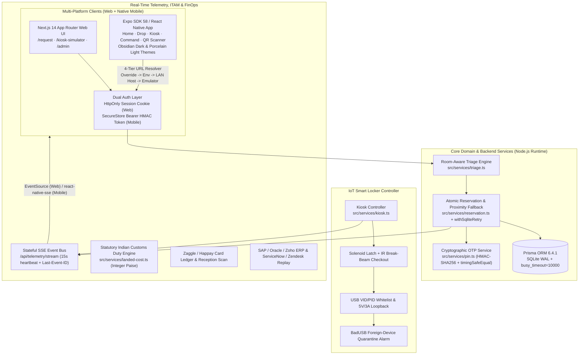

<div align="center">

# KioskDrop Enterprise

### Automated Conference & Presentation Kit Smart-Locker, Zero-Trust IoT & FinOps Platform (Web + Native Mobile)

[](https://nextjs.org/)
[](https://expo.dev/)
[](https://reactnative.dev/)
[](https://www.typescriptlang.org/)
[](https://www.prisma.io/)
[](https://vitest.dev/)
[](https://github.com/AgrShubham/kioskdrop-mobile/releases/tag/v1.0.0)
[](mobile/LICENSE)

<br/>

**Eliminating "last-meter" corporate boardroom Audio/Visual (AV) failures through sub-60-second autonomous hardware triage, distributed IoT smart lockers, Zero-Trust USB whitelisting, real-time SSE telemetry, and statutory FinOps micro-logistics — across Next.js Web and React Native (iOS, Android & Expo Web).**

[Download Android APK (v1.0.0)](https://github.com/AgrShubham/kioskdrop-mobile/releases/tag/v1.0.0) •
[System Architecture](#system-architecture) •
[Mobile App](#mobile-companion-app-expo-sdk-58) •
[Quick Start](#quick-start) •
[Engineering Rigor](#engineering--mathematical-rigor) •
[API Reference](#api-specification) •
[Project Guide](PROJECT_GUIDE.md)

</div>

---

> [!NOTE]
> **Operational Posture Notice ([ADR D1](docs/DECISIONS.md)):** KioskDrop Enterprise is architected as a **Production-Quality Enterprise Simulator & Reference Architecture**. Core domain state machines, atomic SQLite WAL reservations, cryptographic OTP generation/verification, SHA-256 hash-chained custody logs, SSE telemetry streaming, and statutory Indian customs duty paise arithmetic are fully implemented and verified by automated tests. External third-party enterprise systems (ServiceNow/Zendesk webhooks, Zaggle/Happay corporate prepaid cards, SAP/Oracle/Zoho ERPs, and WPC ETA / BIS CRS regulatory portals) operate through clean, contract-validated mock adapter boundaries.

---

## Table of Contents

- [Repository Branch Matrix](#repository-branch-matrix)
- [Executive Problem Statement](#executive-problem-statement)
- [System Architecture](#system-architecture)
- [Web & Mobile Operational Surfaces](#web--mobile-operational-surfaces)
- [Mobile Companion App (Expo SDK 58)](#mobile-companion-app-expo-sdk-58)
- [Standalone Android Release APK (v1.0.0)](#standalone-android-release-apk-v100)
- [Engineering & Mathematical Rigor](#engineering--mathematical-rigor)
  - [1. Statutory Customs Duty Engine (Integer Paise)](#1-statutory-customs-duty-engine-integer-paise)
  - [2. Concurrency & Race-Condition Resistance](#2-concurrency--race-condition-resistance)
  - [3. Cryptographic PIN & Timing-Safe Session Security](#3-cryptographic-pin--timing-safe-session-security)
  - [4. Tamper-Evident SHA-256 Custody Chain](#4-tamper-evident-sha-256-custody-chain)
- [Repository Structure](#repository-structure)
- [Quick Start](#quick-start)
  - [1. Backend & Web App (Repository Root)](#1-backend--web-app-repository-root)
  - [2. Mobile App (Expo Go, Emulator, Web)](#2-mobile-app-expo-go-emulator-web)
  - [3. Building a Standalone Android APK Locally or via EAS](#3-building-a-standalone-android-apk-locally-or-via-eas)
- [Pre-Seeded Personas, Rooms & Hardware Fleet](#pre-seeded-personas-rooms--hardware-fleet)
- [Deployment Options](#deployment-options)
- [Quality Gates & Verification](#quality-gates--verification)
- [API Specification](#api-specification)
- [Architecture Decision Records (ADRs)](#architecture-decision-records-adrs)
- [Documentation & Media Tooling](#documentation--media-tooling)

---

## Repository Branch Matrix

| Branch | Purpose | Database Driver | Highlights |
| :--- | :--- | :--- | :--- |
| **`main`** | Primary unified production codebase | SQLite WAL (`file:./dev.db`) | Next.js 14 backend + Web UI, Expo SDK 58 Mobile app (`mobile/`), Android APK release plugin, [PROJECT_GUIDE.md](PROJECT_GUIDE.md) |
| **`experimental`** | Active feature & mobile integration branch | SQLite WAL (`file:./dev.db`) | Synced cleanly with `main` (default repo branch on GitHub) |
| **`docker`** | Containerized standalone deployment target | SQLite WAL (Docker volume) | Multi-stage `Dockerfile` + `docker-compose.yml` entrypoint automation |
| **`vercel-serverless`** | Ephemeral cloud web demo target | Neon PostgreSQL (`@neon/*`) | Serverless-adapted config + executive presentation artifacts |

---

## Executive Problem Statement

Enterprise meeting rooms routinely lose critical minutes—and expose corporate networks—due to five compounding failures:

1. **The "Last-Meter" Dongle Crisis:** Missing USB-C DP Alt Mode adapters, incompatible display cables, HDCP 2.2 handshakes failing on 4K LED walls, or dead wireless clickers stall executive presentations.
2. **IT Helpdesk Dispatch Latency:** Manual desk-side dispatch routinely costs 15–30 minutes of high-value conference room time.
3. **BadUSB & Counterfeit Hardware Risks:** Unmanaged personal or uncertified USB peripherals introduce keystroke-injection payloads (`0x16C0 / 0x05DF`) and unapproved wireless transmitters.
4. **Inventory Shrinkage & Zero Accountability:** Adapters vanish from shared boardrooms without room-level anomaly detection or serialized chain-of-custody tracking.
5. **Cross-Border Customs & FinOps Friction:** Direct-import AV procurement across HSN tariffs (`BCD`, `SWS`, `IGST` + ITC recovery) and corporate expense card reconciliation require audit-grade precision.

**KioskDrop Enterprise resolves these in under 60 seconds** via self-service QR triage, atomic smart-locker bay locking, Zero-Trust hardware probes, and real-time ITAM/FinOps synchronization.

---

## System Architecture



---

## Web & Mobile Operational Surfaces

| Workflow | Web Route | Mobile Screen | Capabilities |
| :--- | :--- | :--- | :--- |
| **Gateway & Live Hub Overview** | `/` | `Home` (`mobile/app/(tabs)/index.tsx`) | Live fleet capacity snapshot (`Ready`, `Reserved`, `In Use`, `Quarantine`), quick role switcher trigger, QR scanner launch |
| **Camera QR Scanner** | URL query (`?room=...`) | `Scanner` (`mobile/app/scanner.tsx`) | `expo-camera` barcode scanner parsing `kioskdrop://` URLs & JSON room/locker slugs with manual fallback |
| **Rapid-Drop AV Triage** | `/request` | `Drop` (`mobile/app/(tabs)/request.tsx`) | Room selector, 5 failure-mode diagnostics, `Port Damaged` wireless override toggle, tear-off 6-digit OTP ticket with countdown |
| **IoT Smart Locker Terminal** | `/kiosk-simulator` | `Kiosk` (`mobile/app/(tabs)/kiosk.tsx`) | 12-bay hub selector & live LED grid, tactile keypad with 5-attempt 15-min lockout, NFC/RFID tap, biometric MFA, break-beam checkout & BadUSB return simulation |
| **Command Center (ITAM & FinOps)** | `/admin` | `Command` (`mobile/app/(tabs)/admin.tsx`) | RBAC-guarded Zero-Trust USB whitelist (`VID/PID`, `WPC ETA`, `BIS CRS`), Customs Duty calculator, Zaggle/Happay PO replenishment, reception intake scan, anomaly chart, webhook replay |

---

## Mobile Companion App (Expo SDK 58)

Located under [`mobile/`](mobile/README.md), the React Native companion app delivers full functional parity across **Android**, **iOS**, and **Expo Web**:

- **Stateless Bearer Authentication (`mobile/src/lib/storage.ts`, `src/lib/session.ts`):** Switching personas calls `POST /api/session/role`, returning an HMAC-signed token stored encrypted inside `expo-secure-store` (with AsyncStorage fallback on web) and attached via `Authorization: Bearer <token>` on every API and SSE request.
- **4-Tier Server URL Resolver (`mobile/src/lib/env.ts`):** Automatically resolves backend targets without rebuilding:
  1. Live user override saved in Zustand (`Persona & Server` sheet)
  2. `EXPO_PUBLIC_API_URL` build/env variable
  3. Automatic Expo Go LAN IP extraction (`Constants.expoConfig.hostUri` -> `http://<LAN-IP>:3000`)
  4. Platform default (`http://10.0.2.2:3000` on Android, `http://localhost:3000` on iOS/Web)
- **Hermes-Safe SSE Telemetry (`mobile/src/hooks/useTelemetrySSE.ts`):** Uses `react-native-sse` with `Last-Event-ID` support, `AppState` background pausing, exponential reconnect backoff (`2s -> 15s`), targeted React Query cache invalidation, and error haptics on `SECURITY_MISMATCH_ALARM`.
- **Dual-Theme Design System (`mobile/src/lib/theme.ts`, `mobile/app/_layout.tsx`):** Redesigned **Obsidian Studio Dark** (`#070A10` canvas, `#0F1521` elevated bar) and **Porcelain Crisp Light** (`#F3F5F9` / `#FFFFFF`) palettes with dynamic Android `SystemUI` and `expo-navigation-bar` edge-to-edge synchronization so system gesture bars always match the active app theme.
- **Deep Linking (`kioskdrop://`):**
  - `kioskdrop://request?room=Boardroom-4B&floor=4`
  - `kioskdrop://kiosk?locker=lkr_floor4&bay=1&pin=123456`

---

## Standalone Android Release APK (v1.0.0)

A verified, standalone release APK is published on GitHub Releases — no Expo Go client required:

- **GitHub Release:** [KioskDrop Enterprise v1.0.0 (Android APK)](https://github.com/AgrShubham/kioskdrop-mobile/releases/tag/v1.0.0)
- **Direct Download:** [kioskdrop-enterprise.apk](https://github.com/AgrShubham/kioskdrop-mobile/releases/download/v1.0.0/kioskdrop-enterprise.apk) (`72,996,393` bytes / `69.6 MB`)
- **Application ID / Version:** `com.kioskdrop.enterprise` (`versionName 1.0.0`, `versionCode 1`, `minSdkVersion 24`, `targetSdkVersion 36`)
- **Supported ABIs:** `arm64-v8a` (modern physical Android devices) + `x86_64` (Windows/macOS Android Emulators)
- **Cleartext Local Network Pairing:** Built with [`mobile/plugins/withCleartextTraffic.js`](mobile/plugins/withCleartextTraffic.js) (`android:usesCleartextTraffic="true"`) so installed APKs can pair seamlessly with both local `http://10.0.2.2:3000` / LAN `http://<PC-IP>:3000` backends and HTTPS deployments.
- **SHA-256 Checksum:** `ac5e2c7bc2893009346ddd6d39f68ac458c22a9c2fd249bc75cd07b4b1a4736b`
- **Signing Note:** V2-signed with Android Debug keystore for direct sideloading and `adb install -r` evaluation (configure a production upload keystore or EAS Build credentials prior to Play Store distribution).

---

## Engineering & Mathematical Rigor

### 1. Statutory Customs Duty Engine (Integer Paise)

All monetary storage and arithmetic across Prisma and [`src/services/landed-cost.ts`](src/services/landed-cost.ts) uses **integer paise** (`1 INR = 100 paise`) and **basis points** (`100 bp = 1.00%`) with round-half-up applied independently to each statutory component (zero IEEE 754 floats):

1. **Assessable Value ($V_a$)** (`1%` landing charges on CIF):
   $$V_a = \lfloor V_{\text{CIF}} \times 1.01 + 0.5 \rfloor$$
2. **Basic Customs Duty ($\text{BCD}$)** (default `2000 bp` = `20.00%` of $V_a$):
   $$\text{BCD} = \lfloor V_a \times 0.20 + 0.5 \rfloor$$
3. **Social Welfare Surcharge ($\text{SWS}$)** (default `1000 bp` = `10.00%` of $\text{BCD}$):
   $$\text{SWS} = \lfloor \text{BCD} \times 0.10 + 0.5 \rfloor$$
4. **Integrated GST ($\text{IGST}$)** (default `1800 bp` = `18.00%` on $V_a + \text{BCD} + \text{SWS}$):
   $$\text{IGST} = \lfloor (V_a + \text{BCD} + \text{SWS}) \times 0.18 + 0.5 \rfloor$$

*Verified Golden Test Vectors ([`test/landed-cost.test.ts`](test/landed-cost.test.ts)):*
- **Direct Import — ₹1,000.00 (`100,000` paise):** `Va = ₹1,010.00`, `BCD = ₹202.00`, `SWS = ₹20.20`, `IGST = ₹221.80` -> **Total Duties = ₹444.00 (`44.40%`)**, **Landed Cost = ₹1,444.00**, **Net of ITC = ₹1,222.20**.
- **Direct Import — ₹34,000.00 (`3,400,000` paise):** `Va = ₹34,340.00`, `BCD = ₹6,868.00`, `SWS = ₹686.80`, `IGST = ₹7,541.06` -> **Total Duties = ₹15,095.86**, **Landed Cost = ₹49,095.86**, **Net of ITC = ₹41,554.80**.
- **Domestic Wholesale Mode:** Skips customs `BCD`/`SWS` (`₹0.00`) and computes standard `18%` GST recoverable 100% as Input Tax Credit (`effectiveCostNetOfItcPaise === cifAmountPaise`).

### 2. Concurrency & Race-Condition Resistance

In [`src/services/reservation.ts`](src/services/reservation.ts), scarce physical bays are claimed via **atomic conditional `updateMany` guards** wrapped in explicit Prisma transaction timeouts (`maxWait: 10000, timeout: 15000`) and SQLite WAL jittered retry logic (`withSqliteRetry`, up to 20 retries):

```typescript
const claimed = await tx.lockerCompartment.updateMany({
  where: {
    id: candidate.id,
    status: CompartmentStatus.STOCKED_AVAILABLE,
  },
  data: {
    status: CompartmentStatus.RESERVED_FOR_PICKUP,
    activePinHash: pinHash,
  },
});

if (claimed.count !== 1) {
  // Concurrent requester claimed this bay first -> retry next candidate / proximity floor
  continue;
}
```

- **Verified by [`test/concurrency.test.ts`](test/concurrency.test.ts):** **20 simultaneous workers** contend for **1 stocked unit** — **exact result: 1 reservation succeeds, 19 fail cleanly with `NoStockAvailableError`, zero double-bookings**.

### 3. Cryptographic PIN & Timing-Safe Session Security

- **OTP Generation & Storage ([`src/services/pin.ts`](src/services/pin.ts)):** `crypto.randomInt(0, 1_000_000)` padded to 6 digits, hashed immediately via `HMAC-SHA256` with `SERVER_PIN_PEPPER`. Raw PINs are never persisted in SQLite.
- **Constant-Time Verification:** `verifyPin` compares fixed-length buffers via `crypto.timingSafeEqual`, preventing timing side-channel leaks.
- **Keypad Brute-Force Lockout (`src/lib/locker-lockout.ts`):** 5 consecutive failed unlock attempts trigger a 15-minute terminal security lockout (`HTTP 423 LOCKER_LOCKED_OUT`); foreign USB HID or VID/PID mismatch probes transition the compartment to `MAINTENANCE_QUARANTINE` and broadcast a BadUSB alarm.
- **Session Verification ([`src/lib/session.ts`](src/lib/session.ts)):** Both web cookies (`kioskdrop_session`) and mobile Bearer tokens (`Authorization: Bearer <token>`) are verified with `HMAC-SHA256` + `crypto.timingSafeEqual`.

### 4. Tamper-Evident SHA-256 Custody Chain

Every reservation, solenoid unlock, break-beam checkout, return probe, TTL expiry (`cleanupExpiredReservations`), and BadUSB quarantine event appends an immutable `CustodyLog` record chained to the previous entry:

$$H_n = \text{SHA-256}\bigl(H_{n-1} : \text{eventType} : \text{timestamp} : \text{details}\bigr)$$

*(Starting from genesis hash `"0".repeat(64)`.)*

---

## Repository Structure

```text
KioskDrop App/
├── README.md                              # Project documentation & architecture hub
├── PROJECT_GUIDE.md                       # Complete setup, mobile, emulator & troubleshooting guide
├── package.json                           # Root scripts (dev, build, lint, test, db:seed, record:synced)
├── next.config.js                         # Next.js 14 config + /api CORS headers for Expo Web/Mobile
├── prisma/
│   ├── schema.prisma                      # SQLite WAL schema (13 relational models, integer paise, indexes)
│   └── seed.ts                            # Enterprise seed (3 personas, 4 rooms, 2 hubs / 24 bays, anomalies)
├── src/
│   ├── app/                               # Next.js App Router pages (/, /request, /kiosk-simulator, /admin)
│   │   └── api/                           # 19 REST + SSE Route Handlers
│   ├── domain/states.ts                   # Pure compartment & ticket FSM transition guards
│   ├── lib/                               # Prisma WAL singleton, HMAC session (Cookie+Bearer), SSE telemetry bus
│   ├── services/                          # triage, reservation, pin, kiosk, landed-cost, webhook services
│   ├── components/                        # Web UI navbar & interactive views
│   └── hooks/useTelemetry.ts              # Web EventSource SSE subscriber
├── mobile/                                # React Native / Expo SDK 58 companion workspace
│   ├── app/
│   │   ├── _layout.tsx                    # Root shell, QueryClient, dynamic SystemUI & Android NavigationBar
│   │   ├── scanner.tsx                    # Native expo-camera QR & barcode modal
│   │   ├── +not-found.tsx                 # Fallback route handler
│   │   └── (tabs)/                        # Bottom-tab screens: index, request, kiosk, admin
│   ├── plugins/withCleartextTraffic.js    # Custom Expo config plugin for Release APK LAN/emulator HTTP
│   ├── src/
│   │   ├── components/                    # Layout header/sheets + request, kiosk, admin & UI primitives
│   │   ├── constants/                     # Diagnostic symptom matrix, API presets, HSN options, BadUSB vector
│   │   ├── hooks/                         # useSession, useTelemetrySSE (react-native-sse + haptics)
│   │   ├── lib/                           # API client, 4-tier env resolver, formatters, QR parser, SecureStore, theme
│   │   ├── schemas/api.ts                 # Zod runtime validation schemas for API payloads
│   │   ├── store/app-store.ts             # Zustand persisted UI/theme/override state
│   │   └── types/domain.ts                # Shared TypeScript interfaces
│   ├── __tests__/                         # 5 Jest + RNTL test suites (24 passing tests)
│   ├── app.json                           # Expo app metadata, scheme (kioskdrop://), native plugins
│   ├── eas.json                           # EAS Build profiles (development, preview APK, production)
│   └── README.md                          # Dedicated mobile development & EAS build guide
├── test/                                  # 7 Vitest backend/API/concurrency suites (39 passing tests)
├── docs/                                  # Architecture Decision Records, Business Deck (.md/.docx/.pdf), Guides
├── scripts/                               # Mobile audit, Playwright demo recorder & edge-TTS voiceover utilities
├── Dockerfile & docker-compose.yml        # Containerized stateful production stack
```

---

## Quick Start

### Prerequisites

- **Node.js** `>= 18.18.0` (verified on `v20.x` and `v25.x`) and **npm** `>= 9.0.0`
- **Optional (Mobile Emulator / APK builds):** **Expo Go** on Android/iOS, or **Android Studio + SDK + JDK 17** (`JAVA_HOME`)

### 1. Backend & Web App (Repository Root)

```bash
git clone https://github.com/AgrShubham/kioskdrop-mobile.git
cd kioskdrop-mobile
npm install
```

Copy environment variables and initialize SQLite WAL + seed data:

```bash
# macOS / Linux:
cp .env.example .env

# Windows PowerShell:
Copy-Item .env.example .env
```

```bash
npx prisma generate
npx prisma db push
npm run db:seed
```

Start the Next.js server bound on `0.0.0.0:3000` so both browser tabs and LAN/emulator mobile devices can reach `/api/*`:

```bash
npx next dev -H 0.0.0.0 -p 3000
# Open http://localhost:3000
```

> [!TIP]
> On Windows, if physical devices on your Wi-Fi timeout reaching port `3000`, allow inbound TCP `3000` in an elevated PowerShell prompt:
> ```powershell
> New-NetFirewallRule -DisplayName "KioskDrop Nextjs Dev 3000" -Direction Inbound -Protocol TCP -LocalPort 3000 -Action Allow
> ```

---

### 2. Mobile App (Expo Go, Emulator, Web)

In a **second terminal** while the Next.js server runs on port `3000`:

```bash
cd mobile
npm install
npm start
```

From the Expo Metro prompt:
- Press **`a`** — Open in a running **Android Emulator** (auto-targets `http://10.0.2.2:3000`; or run `adb reverse tcp:3000 tcp:3000`)
- Press **`i`** — Open in **iOS Simulator** *(macOS only)*
- Press **`w`** — Open **Expo Web** (`http://localhost:8081` -> CORS-enabled `http://localhost:3000`)
- **Scan QR Code** — Open immediately on a physical phone via **Expo Go** on the same Wi-Fi (`http://<YOUR-PC-LAN-IP>:3000`)

Verify server connectivity inside the mobile app via **Header Persona Pill (`EMP` / `IT` / `FIN`) -> Server Connection -> Test Ping**.

---

### 3. Building a Standalone Android APK Locally or via EAS

#### Option A: Install Pre-Built Release APK (`v1.0.0`)
Download [`kioskdrop-enterprise.apk`](https://github.com/AgrShubham/kioskdrop-mobile/releases/download/v1.0.0/kioskdrop-enterprise.apk) or install via ADB:

```bash
adb install -r kioskdrop-enterprise.apk
```

#### Option B: Local Gradle Release Build (Windows / macOS / Linux)
Requires Android SDK + JDK 17 (`JAVA_HOME`):

```powershell
cd mobile
$env:CI = "1"
npx expo prebuild --platform android --clean

cd android
.\gradlew.bat assembleRelease "-PreactNativeArchitectures=arm64-v8a,x86_64" --max-workers=2 --no-daemon
# Output: mobile/android/app/build/outputs/apk/release/app-release.apk
```

> [!NOTE]
> **Windows `MAX_PATH` Fix for CMake/Ninja:** Deep repo paths on Windows can hit Ninja's 260-character object file limit during native `react-native-worklets` / `rngesturehandler_codegen` builds. If encountered locally, configure a short `externalNativeBuild.cmake.buildStagingDirectory` (e.g., `C:/x/...`) and `-DCMAKE_OBJECT_PATH_MAX=245` in `mobile/android/build.gradle` and `mobile/android/app/build.gradle`.

#### Option C: Expo Application Services (EAS Cloud Build)

```bash
cd mobile
npx eas-cli login
npx eas-cli build --platform android --profile preview
```

---

## Pre-Seeded Personas, Rooms & Hardware Fleet

Use the interactive **Role / Persona Switcher** (top header bar on both Web & Mobile) to test RBAC and persona flows:

| Persona | Role | RFID Badge | Authorized Views & Actions |
| :--- | :--- | :--- | :--- |
| **Aarav Sharma** | `EMPLOYEE` | `RFID-EMP-8821` | Room triage (`/request`, `Drop`), locker pickup/return (`/kiosk-simulator`, `Kiosk`), duty estimator preview |
| **Priya Patel** | `IT_ADMIN` | `RFID-IT-0042` | Full access to Zero-Trust USB Whitelist toggles, anomaly telemetry, reception intake scan, webhook replay (`Command`) |
| **Vikram Malhotra** | `FINOPS_AUDITOR` | `RFID-FIN-1109` | Customs landed-cost modeling, Zaggle/Happay card ledger, SAP/Oracle/Zoho PO replenishment & reception (`Command`) |

**Seeded Infrastructure Highlights:**
- **Meeting Rooms (4):** `Executive Boardroom 4B` *(pre-seeded shrinkage anomaly)*, `Innovation Lab 4A`, `Townhall Auditorium 2A`, `Client Pitch Room 3C` *(tests floor-distance proximity fallback cleanly since Floor 3 has no hub)*.
- **Smart Locker Fleet (2 Hubs / 24 Bays):** `Floor 4 Boardroom Hub` (12 bays) and `Floor 2 Townhall Hub` (12 bays).
- **Hardware SKUs & HSN Tariffs:** 7 enterprise SKUs (Anker A8338-PRO USB-C 60W Hub, Barco CS-400W 4K Wireless HDMI, Kramer VP-427A HDCP 2.2 Scaler, Belkin HDMI 2.1, Club3D DP 1.4, Logitech Spotlight BLE, Shure CVB-B/O Mic) across HSN codes `85437099`, `85182210`, `85444299`, and `85181000`.

---

## Deployment Options

See [`docs/DEPLOYMENT_GUIDE.md`](docs/DEPLOYMENT_GUIDE.md) for complete production instructions.

### Stateful Docker Compose (Recommended for Self-Hosted / VPS)

Because persistent SSE telemetry streams (`/api/telemetry/stream`) and SQLite WAL live inside a single stateful Node.js process ([ADR D3](docs/DECISIONS.md)), containerized hosting preserves full real-time parity:

```bash
cp .env.example .env
# Update SESSION_SECRET, SERVER_PIN_PEPPER, WEBHOOK_SIGNING_SECRET for production
docker compose up -d --build
```

The [`docker-entrypoint.sh`](docker-entrypoint.sh) script runs Prisma schema sync / seed safely against a persistent SQLite volume mounted inside the container. Switch to the `vercel-serverless` branch if deploying to Vercel + Neon PostgreSQL.

---

## Quality Gates & Verification

Both workspaces enforce strict TypeScript checks and automated test suites (**63/63 tests passing**):

### Root Backend & Domain Checks

```bash
npm run typecheck    # Strict tsc --noEmit (0 errors)
npm run lint         # ESLint check (0 errors)
npm run test         # Vitest single-thread suite: 7/7 files, 39/39 tests
npm run build        # prisma generate && next build (7 static pages + 19 API routes)
```

<details>
<summary>Root Vitest Suite Breakdown (39/39 Passing)</summary>

| Test File | Scope | Tests |
| :--- | :--- | :--- |
| `test/api-integration.test.ts` | End-to-end REST endpoints, auth, triage, compliance & FinOps | 10 |
| `test/states.test.ts` | Compartment & Dispatch Ticket state machine transition guards | 8 |
| `test/triage.test.ts` | Symptom-to-SKU routing & `Port Damaged` wireless override | 8 |
| `test/kiosk.test.ts` | PIN lockout, IR break-beam removal, VID/PID probe & BadUSB quarantine | 5 |
| `test/pin.test.ts` | CSPRNG OTP formatting, HMAC-SHA256 hashing & timing-safe compare | 4 |
| `test/landed-cost.test.ts` | Golden Test Vectors A & B + domestic ITC recovery math | 3 |
| `test/concurrency.test.ts` | 20 concurrent asynchronous workers contending for 1 bay | 1 |

</details>

### Mobile App Checks (`mobile/`)

```bash
cd mobile
npm run typecheck                    # Strict tsc --noEmit (0 errors)
npm test                             # Jest + React Native Testing Library: 5/5 suites, 24/24 tests
npx expo-doctor                      # Expo SDK 58 config & dependency validation
npx expo export --platform web --platform android --clear  # Production Metro/Hermes bundle export
```

<details>
<summary>Mobile Jest & RNTL Suite Breakdown (24/24 Passing)</summary>

| Test Suite | Scope | Tests |
| :--- | :--- | :--- |
| `mobile/__tests__/format.test.ts` | INR paise & compact tick formatting, Customs Duty Golden Vectors A & B, countdowns, labels & 4-tier URL resolver | 9 |
| `mobile/__tests__/qr-parser.test.ts` | `kioskdrop://` deep links, trusted HTTPS links, JSON payloads, untrusted URL rejection & PIN sanitization | 6 |
| `mobile/__tests__/request-triage.test.tsx` | Floor 3 -> Floor 4 fallback notice, `portDamaged` wireless override, OTP pass card & masked replay guard | 2 |
| `mobile/__tests__/keypad-kiosk.test.tsx` | Offline/loading gating, PIN validation, unlock, `401`/`423` lockout handling & RFID/Biometric flows | 5 |
| `mobile/__tests__/admin-rbac.test.tsx` | RBAC-guarded HID toggles, SecureStore Bearer persistence on role switch & Landed-Cost Vector A UI | 2 |

</details>

---

## API Specification

All API routes run on the Node.js runtime (`force-dynamic`) with CORS headers configured in [`next.config.js`](next.config.js) and accept either cookie sessions or `Authorization: Bearer <token>`.

| Category | Endpoint | Method | Description |
| :--- | :--- | :--- | :--- |
| **Session & Auth** | `/api/session/current` | `GET` | Returns active persona session (`UserSession`) |
| | `/api/session/role` | `POST` | Switches persona role (`EMPLOYEE`, `IT_ADMIN`, `FINOPS_AUDITOR`), returns cookie + Bearer `token` |
| **Triage & Fleet** | `/api/rooms` | `GET` | Lists corporate meeting rooms, floors, display types & QR slugs |
| | `/api/diagnose-and-reserve` | `POST` | Diagnoses AV symptom, performs atomic bay claim, returns 6-digit OTP & expiry |
| | `/api/lockers` | `GET` | Lists smart locker hubs, temperatures, bay states & stocked SKUs (triggers lazy expiry sweep) |
| | `/api/realtime/live-lockers` | `GET` | Realtime locker status polling fallback endpoint |
| **Kiosk Hardware** | `/api/kiosk/authenticate-and-unlock` | `POST` | Validates PIN / RFID badge / Biometric ref & unlocks bay solenoid |
| | `/api/kiosk/remove-asset` | `POST` | Triggers optoelectronic IR break-beam sensor checkout (`CHECKED_OUT`) |
| | `/api/kiosk/return-asset` | `POST` | Probes USB VID/PID & 5V/3A charging continuity on asset return |
| | `/api/kiosk/report-foreign-device` | `POST` | Quarantines compartment (`MAINTENANCE_QUARANTINE`) & emits BadUSB alarm |
| **Telemetry** | `/api/telemetry/stream` | `GET` | Server-Sent Events stream with `15s` keepalive heartbeats & custody event broadcasts |
| **Admin & FinOps** | `/api/admin/compliance` | `GET`, `POST` | Lists Zero-Trust hardware assets, BIS/WPC metadata & toggles `hidWhitelisted` |
| | `/api/admin/compliance/landed-cost` | `POST` | Computes statutory Indian customs duty breakdown in integer paise |
| | `/api/admin/finops` | `GET`, `POST` | Fetches Zaggle/Happay card ledger & creates SAP/Oracle/Zoho restock POs |
| | `/api/admin/reception/scan` | `POST` | Inspects incoming PO shipments & restocks locker bays (`IT_ADMIN` / `FINOPS_AUDITOR`) |
| | `/api/admin/analytics` | `GET` | Shrinkage anomaly heuristics, floor utilization & checkout distribution |
| | `/api/admin/webhooks` | `GET`, `POST` | Lists ServiceNow/Zendesk webhook audit logs & replays events by ID |
| **External Webhooks** | `/api/webhooks/servicenow` | `POST` | HMAC-SHA256 verified inbound ServiceNow ticket webhook |
| | `/api/webhooks/zendesk` | `POST` | HMAC-SHA256 verified inbound Zendesk ticket webhook |

---

## Architecture Decision Records (ADRs)

Full design rationale is documented in [`docs/DECISIONS.md`](docs/DECISIONS.md):

- **D1 — Enterprise Simulator Posture:** Authentic contracts, isolated mock adapter boundaries for external ERP/ITSM/regulatory endpoints.
- **D2 — SQLite WAL + Atomic Conditional Updates:** Zero-dependency local concurrency (`PRAGMA journal_mode = WAL`, `busy_timeout = 10000`, `updateMany` optimistic bay lock, explicit SQLite indexes).
- **D3 — Stateful Node.js Runtime:** Supports persistent SSE pub/sub (`telemetry-bus.ts`) and local background timers without mandatory Redis infrastructure.
- **D4 — Exact Version Pinning:** Pinned core Next.js 14 / React 18 / Prisma 6 / Tailwind 3 versions at root for deterministic CI/Docker builds.
- **D5 — Shared Service Layer:** Web Route Handlers, Server Actions, and Mobile API callers share the exact same domain services in `src/services/`.
- **D6 — Integer Paise & Basis Points:** All financial figures stored as integer paise (`Int`) and tariff percentages as basis points (`Int`).

---

## Documentation & Media Tooling

- **[PROJECT_GUIDE.md](PROJECT_GUIDE.md):** Complete developer walkthrough covering branch differences, backend + Expo Go setup, Android emulator launch, UI architecture, and troubleshooting.
- **[mobile/README.md](mobile/README.md):** Dedicated Expo SDK 58 setup, LAN firewall rules, deep-link CLI testing, and EAS build instructions.
- **[docs/MOBILE_APP_USER_GUIDE.md](docs/MOBILE_APP_USER_GUIDE.md):** End-user walkthrough for Employee, IT Admin, and FinOps mobile personas.
- **[docs/BUSINESS_DECK.md](docs/BUSINESS_DECK.md):** 12-page executive business presentation ([DOCX](docs/KioskDrop_Enterprise_12_Page_Business_Deck.docx) · [PDF](docs/KioskDrop_Enterprise_12_Page_Business_Deck.pdf)).
- **[docs/DEPLOYMENT_GUIDE.md](docs/DEPLOYMENT_GUIDE.md):** Docker, Railway, Render, VPS, Nginx, and Vercel Serverless deployment guides.
- **[docs/DEMO_VIDEO_GUIDE_AND_SCRIPT.md](docs/DEMO_VIDEO_GUIDE_AND_SCRIPT.md):** Automated Playwright screen recording (`npm run record:video` / `npm run record:synced`) & AI voiceover (`npm run demo:voiceover`) guide.
- **[docs/SECURITY_AUDIT_EXCEPTIONS.md](docs/SECURITY_AUDIT_EXCEPTIONS.md):** Documented simulator security scope & mitigations.

---

<div align="center">

**Built with precision for enterprise boardroom AV reliability across Web, Android, and iOS.**

[Back to Top ↑](#kioskdrop-enterprise)

</div>
