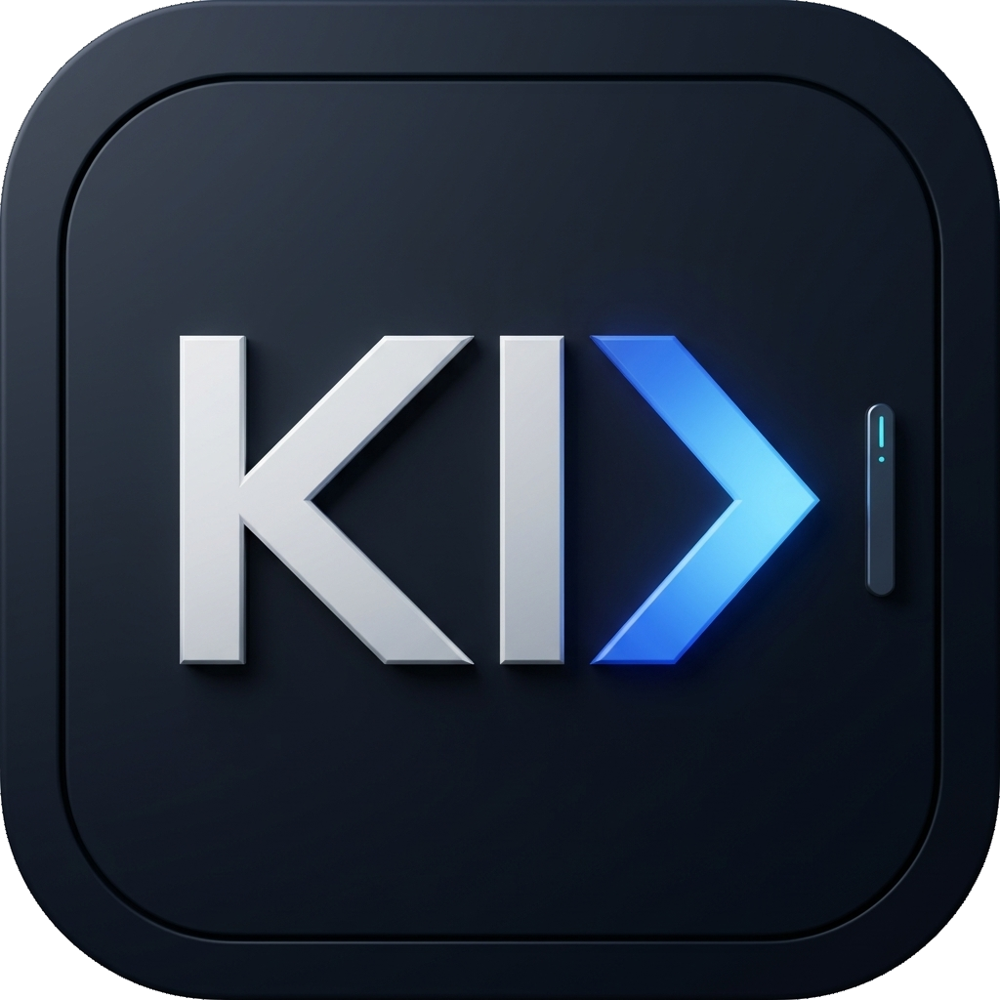
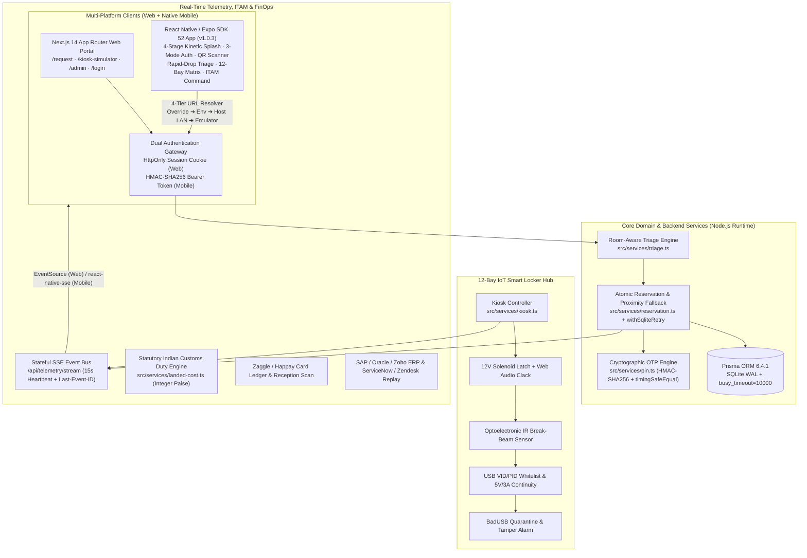

<div align="center">

<p align="center">
  
</p>

# KioskDrop Enterprise

### Zero-Trust AV Micro-Logistics, Smart-Locker Fleet Gateway & Statutory FinOps Platform
**Next.js 14 Web • React Native Mobile (Android / iOS) • IoT Solenoid Hardware Simulator**

[](https://github.com/AgrShubham/kioskdrop-mobile/releases/tag/v1.0.3)
[](https://nextjs.org/)
[](https://reactnative.dev/)
[](https://expo.dev/)
[](https://www.typescriptlang.org/)
[](https://www.prisma.io/)
[](test/)
[](#zero-trust-hardware-security)
[](mobile/LICENSE)

<br/>

**Eliminating "last-meter" corporate boardroom Audio/Visual (AV) failures through sub-60-second autonomous hardware triage, distributed IoT smart lockers, Zero-Trust USB whitelisting, real-time SSE telemetry, and statutory FinOps micro-logistics across responsive Web and native Android/iOS mobile applications.**

[Download Android APK (v1.0.3)](https://github.com/AgrShubham/kioskdrop-mobile/releases/tag/v1.0.3) •
[System Architecture](#system-architecture) •
[Mobile App v1.0.3](#mobile-companion-app-v103) •
[Brand Assets](brand-assets/README.md) •
[Quick Start](#quick-start) •
[Engineering Rigor](#engineering--mathematical-rigor) •
[API Specification](#api-specification) •
[Website Upgrade Plan](KIOSKDROP_WEBSITE_UPGRADE_PLAN.md)

</div>

---

> [!NOTE]
> **Operational Posture Notice ([ADR D1](docs/DECISIONS.md)):** KioskDrop Enterprise is architected as an **industrial-grade Enterprise Simulator & Production Reference Architecture**. Core domain state machines, atomic SQLite WAL reservations, cryptographic OTP generation/verification, SHA-256 hash-chained custody logs, real-time Server-Sent Events (SSE) telemetry, and statutory Indian customs duty integer-paise arithmetic are fully implemented and verified by automated quality gates. External enterprise endpoints (ServiceNow/Zendesk webhooks, Zaggle/Happay corporate prepaid cards, SAP/Oracle/Zoho ERPs, and WPC ETA / BIS CRS regulatory registries) execute through contract-validated mock adapter boundaries.

---

## Table of Contents

- [Executive Summary & Problem Statement](#executive-summary--problem-statement)
- [System Architecture](#system-architecture)
- [Operational Surfaces (Web + Native Mobile)](#operational-surfaces-web--native-mobile)
- [Mobile Companion App (v1.0.3)](#mobile-companion-app-v103)
- [Brand Identity & Design System](#brand-identity--design-system)
- [Zero-Trust Hardware Security](#zero-trust-hardware-security)
- [Statutory Customs & FinOps Engine](#statutory-customs--finops-engine)
- [Engineering & Mathematical Rigor](#engineering--mathematical-rigor)
  - [1. Statutory Customs Duty Engine (Integer Paise)](#1-statutory-customs-duty-engine-integer-paise)
  - [2. Atomic Concurrency & Race-Condition Resistance](#2-atomic-concurrency--race-condition-resistance)
  - [3. Cryptographic PIN & Timing-Safe Verification](#3-cryptographic-pin--timing-safe-verification)
  - [4. Tamper-Evident SHA-256 Custody Chain](#4-tamper-evident-sha-256-custody-chain)
- [Repository Structure](#repository-structure)
- [Quick Start Guide](#quick-start-guide)
  - [1. Backend & Web App (Root Workspace)](#1-backend--web-app-root-workspace)
  - [2. Native Mobile App (Expo SDK 52)](#2-native-mobile-app-expo-sdk-52)
  - [3. Standalone Android APK Sideload & Local Build](#3-standalone-android-apk-sideload--local-build)
- [Pre-Seeded Personas, Rooms & Hardware Fleet](#pre-seeded-personas-rooms--hardware-fleet)
- [Enterprise Quality Gates & Verification](#enterprise-quality-gates--verification)
- [API Specification](#api-specification)
- [Architecture Decision Records (ADRs)](#architecture-decision-records-adrs)
- [Documentation & Media Tooling](#documentation--media-tooling)

---

## Executive Summary & Problem Statement

Corporate meeting spaces and high-stakes executive boardrooms routinely suffer productivity losses averaging **12 to 18 minutes per incident** due to five compounding hardware and logistical bottlenecks:

1. **The "Last-Meter" Dongle Crisis:** Missing USB-C DisplayPort Alt Mode adapters, incompatible display converters, HDCP 2.2 encryption handshake drops on 4K LED video walls, or depleted wireless presentation clickers.
2. **IT Helpdesk Dispatch Latency:** Traditional manual ticketing and floor technician dispatch takes 15–30 minutes—longer than most short executive huddles.
3. **BadUSB & Peripheral Tampering:** Unmanaged personal dongles or unauthorized rogue USB microcontrollers introduce keystroke-injection firmware payloads (`0x16C0 / 0x05DF`) directly into boardroom compute hubs.
4. **Inventory Shrinkage & Zero Custody Accountability:** Shared conference room adapters vanish without serialized chain-of-custody tracking or room-level anomaly detection.
5. **Cross-Border Customs & FinOps Invoicing Friction:** Procuring enterprise AV gear involves complex Indian customs duties (HSN 85437099 tariffs: `BCD`, `SWS`, `IGST` with Input Tax Credit recovery) and corporate expense card reconciliation (Zaggle, Happay).

**KioskDrop Enterprise resolves these challenges in under 60 seconds** through instant QR-code room triage, atomic smart-locker reservations, hardware-level USB whitelisting, and real-time ITAM/FinOps synchronization.

---

## System Architecture



---

## Operational Surfaces (Web + Native Mobile)

| Operational Workflow | Web Route | Mobile Screen (`mobile/app/`) | Core Capabilities |
| :--- | :--- | :--- | :--- |
| **Gateway & Telemetry Hub** | `/` | `index.tsx` (`Home`) | Live fleet capacity snapshot (`Ready`, `Reserved`, `In Use`, `Quarantine`), real-time SSE heartbeat, quick persona trigger. |
| **Enterprise Authentication** | `/login` & `LoginModal` | `LoginScreen.tsx` | 3 Modes: Corporate credentials, 1-tap quick demo personas, physical RFID badge tap simulation, biometric prompt, server latency ping. |
| **Camera QR Scanner** | URL query (`?room=...`) | `scanner.tsx` (`Scanner`) | Native camera barcode reader parsing `kioskdrop://` URLs & JSON slugs with manual room selection fallback. |
| **Rapid-Drop AV Triage** | `/request` | `request.tsx` (`Drop`) | 5 failure-mode diagnostic matrix, `Port Damaged` wireless override, instant 6-digit locker pickup PIN with countdown timer. |
| **12-Bay IoT Locker Bank** | `/kiosk-simulator` | `kiosk.tsx` (`Kiosk`) | 12-bay floor locker bank, mechanical solenoid clack (Web Audio API), optoelectronic IR beam break, 5-attempt brute-force lockout, IT Admin emergency override. |
| **Command Center (ITAM & FinOps)** | `/admin` | `admin.tsx` (`Command`) | Strict RBAC (hidden for `EMPLOYEE`; 403 Forbidden Access Violation card), USB VID/PID whitelist, statutory HSN tariff calculator, PO replenishment, webhook replay. |

---

## Mobile Companion App (v1.0.3)

The production Android application is compiled and available on GitHub Releases:

- **Official Release:** [KioskDrop Enterprise Mobile v1.0.3](https://github.com/AgrShubham/kioskdrop-mobile/releases/tag/v1.0.3)
- **Direct Download:** [`kioskdrop-enterprise-v1.0.3.apk`](https://github.com/AgrShubham/kioskdrop-mobile/releases/download/v1.0.3/kioskdrop-enterprise-v1.0.3.apk) (`123,942,109` bytes / `118.2 MB`)
- **Package ID / Version:** `com.kioskdrop.enterprise` (`versionName 1.0.3`, `versionCode 4`)
- **Target OS:** Android 9.0+ (`minSdkVersion 24`, `targetSdkVersion 36`)
- **Supported ABIs:** `arm64-v8a` (modern physical hardware) and `x86_64` (emulators)
- **Verified Cryptographic Checksum (SHA-256):**
  ```text
  2C9E9944DE63E72D7A5206B3FCB7573631355BB7CB30771870C407D262C8D076
  ```

### Key v1.0.3 Architecture Features:
1. **4-Stage Aerospace Kinetic Boot Sequence:** Staggered entrance of the KD Monogram, chevron drop flash, typography reveal, aperture zoom-through portal, live hardware telemetry logs, and `sessionStorage` single-run memory gate.
2. **Concentric Hardware Loading Radar:** Pulsing radar waves with rotating indicator and subsystem status codes (`[IOT_SOLENOID_DISPATCH]`, `[RFID_AUTHENTICATING]`).
3. **3-Mode Enterprise Authentication:** Corporate credentials with show/hide password, 1-tap quick demo persona switcher, RFID badge reader simulation with auto-tap chips, and live server latency ping.
4. **Strict Role-Based Access Control (RBAC):** Navigation bar dynamically hides administrative tooling for `EMPLOYEE` users. Deep-linking to unauthorized administrative routes displays a cyber-industrial **403 Forbidden Access Violation** screen.

---

## Brand Identity & Design System

The platform is styled according to the specifications in [`brand-assets/brand-guide.json`](brand-assets/brand-guide.json):

<p align="center">
  
</p>

### Official Color Tokens

| Token Name | Hex Code | HSL Representation | Design System Usage |
| :--- | :--- | :--- | :--- |
| **Obsidian Dark** | `#070A10` | `hsl(220, 39%, 5%)` | Master background for dark theme, splash screen, and terminal displays. |
| **Slate Elevated Card**| `#0F172A` | `hsl(222, 47%, 11%)`| Elevated bento cards, modal sheets, and locker bay housing. |
| **Pure White** | `#FFFFFF` | `hsl(0, 0%, 100%)` | Light mode surface and high-contrast dark mode typography. |
| **Sapphire Blue** | `#2563EB` | `hsl(221, 83%, 53%)`| Primary brand accent, interactive buttons, and `EMPLOYEE` persona tone. |
| **Cyber Sky** | `#38BDF8` | `hsl(199, 95%, 64%)`| Kinetic chevron flash, glowing pulse rings, and telemetry sync indicator. |
| **Emerald Zero-Trust** | `#10B981` | `hsl(160, 84%, 39%)`| Solenoid unlocked status, stock availability, and `IT_ADMIN` persona tone. |
| **Amber Quarantine** | `#F59E0B` | `hsl(38, 92%, 50%)` | Pending reception, active reservation countdown, and `FINOPS_AUDITOR` tone. |
| **Crimson Alarm** | `#EF4444` | `hsl(0, 84%, 60%)` | Hardware tamper alarm, BadUSB rogue device quarantine, and 403 access denial. |

Full brand specifications, typography scales (`Inter`, `JetBrains Mono`), vector SVGs, and high-resolution icons are cataloged in [`brand-assets/README.md`](brand-assets/README.md).

---

## Zero-Trust Hardware Security

```
[ Boardroom AV Port ] ──▶ [ Optical Isolation ] ──▶ [ USB VID/PID Probe ] ──▶ [ Solenoid Matrix ]
                                                            │
                                                     Mismatch / Rogue
                                                            ▼
                                                [ TAMPER / QUARANTINE ]
```

1. **Hardware Whitelist Verification:** Peripherals must match approved enterprise Vendor ID (VID) and Product ID (PID) pairings (e.g., Anker `0x29EA`, Barco `0x0600`, Kramer `0x0001`).
2. **BadUSB Mitigation:** Unrecognized USB devices attempting to register as Human Interface Devices (HID keystroke injection `0x16C0 / 0x05DF`) immediately trigger an optoelectronic lock, trip the `MAINTENANCE_QUARANTINE` compartment state, and broadcast a critical security alarm over the SSE telemetry bus.
3. **Optoelectronic IR Break-Beam Sensor:** Each locker bay houses an optical infrared sensor detecting asset presence. Removal transitions the compartment to `CHECKED_OUT`; replacement triggers a 5V/3A continuity check and auto-locks the mechanical solenoid latch.

---

## Statutory Customs & FinOps Engine

For multinational enterprises importing specialized conference hardware into India, KioskDrop incorporates a statutory landed-cost calculation engine compliant with Indian Customs Tariff and Central Goods and Services Tax (CGST) requirements:

- **Statutory Tariff Classification:** Built for **HSN 85437099** (Electrical machines and apparatus having individual functions, n.e.s. in Chapter 85).
- **Assessable Value ($V_a$):** Standard 1% landing charges applied to Cost, Insurance, and Freight (CIF):
  $$V_a = \lfloor V_{\text{CIF}} \times 1.01 + 0.5 \rfloor$$
- **Basic Customs Duty ($\text{BCD}$):** 20.00% statutory duty on $V_a$.
- **Social Welfare Surcharge ($\text{SWS}$):** 10.00% statutory surcharge levied on BCD.
- **Integrated Goods & Services Tax ($\text{IGST}$):** 18.00% IGST computed on $(V_a + \text{BCD} + \text{SWS})$.
- **Input Tax Credit (ITC) Recovery:** 100% of the IGST component is tracked as recoverable corporate ITC against output tax liability, yielding the effective net landed cost.

---

## Engineering & Mathematical Rigor

### 1. Statutory Customs Duty Engine (Integer Paise)
All monetary calculations in [`src/services/landed-cost.ts`](src/services/landed-cost.ts) are executed in **integer paise** (`1 INR = 100 paise`) and basis points (`100 bp = 1.00%`), using half-up rounding to prevent IEEE 754 floating-point drift:

*Verified Golden Test Vectors ([`test/landed-cost.test.ts`](test/landed-cost.test.ts)):*
- **Direct Import — ₹1,000.00 (`100,000` paise):** $V_a = ₹1,010.00$, $\text{BCD} = ₹202.00$, $\text{SWS} = ₹20.20$, $\text{IGST} = ₹221.80$ ➔ **Total Customs Duty = ₹444.00 (`44.40%`)**, **Landed Cost = ₹1,444.00**, **Net Cost (Post-ITC) = ₹1,222.20**.
- **Direct Import — ₹34,000.00 (`3,400,000` paise):** $V_a = ₹34,340.00$, $\text{BCD} = ₹6,868.00$, $\text{SWS} = ₹686.80$, $\text{IGST} = ₹7,541.06$ ➔ **Total Customs Duty = ₹15,095.86**, **Landed Cost = ₹49,095.86**, **Net Cost (Post-ITC) = ₹41,554.80**.
- **Domestic Wholesale Mode:** Bypasses customs BCD/SWS and applies 18% domestic GST with full ITC credit recovery.

### 2. Atomic Concurrency & Race-Condition Resistance
Locker compartments are claimed through **atomic conditional `updateMany` queries** in Prisma transactions with explicit timeouts and SQLite Write-Ahead Logging (WAL) exponential retry wrappers (`withSqliteRetry`):

```typescript
const claimed = await tx.lockerCompartment.updateMany({
  where: {
    id: candidate.id,
    status: CompartmentStatus.STOCKED_AVAILABLE,
  },
  data: {
    status: CompartmentStatus.RESERVED_FOR_PICKUP,
    activePinHash: pinHash,
  },
});

if (claimed.count !== 1) {
  // Concurrent worker claimed bay first -> failover to next candidate bay / floor
  continue;
}
```

- **Concurrency Verification ([`test/concurrency.test.ts`](test/concurrency.test.ts)):** **20 concurrent asynchronous workers** contend simultaneously for a **single stocked bay** — **result: exactly 1 worker claims the bay, 19 fail safely with `NoStockAvailableError`, with zero double-booking or lock contention deadlocks**.

### 3. Cryptographic PIN & Timing-Safe Verification
- **One-Time Passcode (OTP) Generation ([`src/services/pin.ts`](src/services/pin.ts)):** Uses cryptographically secure pseudorandom numbers (`crypto.randomInt(0, 1_000_000)`), formatted to 6 digits and hashed immediately via `HMAC-SHA256` with a server pepper. Raw PINs are never persisted to storage.
- **Constant-Time Verification:** Compares PIN digests using `crypto.timingSafeEqual` to eliminate timing side-channel attacks.
- **Keypad Brute-Force Lockout ([`src/lib/locker-lockout.ts`](src/lib/locker-lockout.ts)):** 5 consecutive invalid entries trigger a 15-minute terminal lockout (`HTTP 423 LOCKER_LOCKED_OUT`).

### 4. Tamper-Evident SHA-256 Custody Chain
Every reservation, solenoid unlock, break-beam checkout, return scan, and security alarm appends an immutable, hash-chained custody record:

$$H_n = \text{SHA-256}\bigl(H_{n-1} : \text{eventType} : \text{timestamp} : \text{details}\bigr)$$

---

## Repository Structure

```text
KioskDrop App/
├── brand-assets/                          # Official vector & raster brand identity suite
│   ├── brand-guide.json                   # Color tokens, typography, and geometry specifications
│   ├── logo/svg/                          # Master vector brand marks (KD monogram & horizontal locks)
│   ├── logo/png/                          # High-res exports (1024px, 512px, 192px)
│   └── icons/android/                     # Adaptive foreground & background icon layers
├── public/                                # Web public assets & downloadable release files
├── mobile/                                # React Native / Expo SDK 52 mobile application
│   ├── app/                               # Expo Router file-based screens (tabs, scanner, modal)
│   ├── src/components/                    # AppSplashScreen, LoadingScreen, LoginScreen, UI suite
│   ├── src/hooks/                         # useSession, useTelemetrySSE (react-native-sse)
│   ├── src/lib/                           # API client, SecureStore, 4-tier URL resolver, formatters
│   └── __tests__/                         # Jest + React Native Testing Library test suites
├── prisma/
│   ├── schema.prisma                      # Relational schema (13 models, integer paise, indexed WAL)
│   └── seed.ts                            # Enterprise seed (3 personas, 4 rooms, 2 hubs / 24 bays)
├── src/
│   ├── app/                               # Next.js 14 App Router (/, /request, /kiosk-simulator, /admin, /login)
│   │   └── api/                           # 19 REST API & SSE Route Handlers
│   ├── domain/states.ts                   # Finite-state machine transition guards
│   ├── lib/                               # Prisma client, HMAC session security, telemetry bus
│   ├── services/                          # Triage, reservation, pin, kiosk, landed-cost, webhooks
│   └── components/                        # Web UI components, KioskDropLogo, ThemeProvider
├── test/                                  # Vitest backend integration & concurrency test suites
├── docs/                                  # Architecture Decision Records (ADRs), deployment & user guides
├── KIOSKDROP_WEBSITE_UPGRADE_PLAN.md      # Master architectural blueprint for web upgrade
├── TEAM_COMMUNICATION_CONTEXT.md          # AI-assisted team communication & standup context file
├── Dockerfile & docker-compose.yml        # Multi-stage production container configuration
└── package.json                           # Root scripts and workspace dependencies
```

---

## Quick Start Guide

### Prerequisites
- **Node.js** `>= 18.18.0` (LTS Recommended: `v20.x` or `v22.x`)
- **npm** `>= 9.0.0`
- **Optional (for mobile builds):** **Expo Go** app on Android/iOS, or **Android Studio + JDK 17** (`JAVA_HOME`)

### 1. Backend & Web App (Root Workspace)

Clone the repository and install dependencies:

```bash
git clone https://github.com/AgrShubham/kioskdrop-mobile.git
cd kioskdrop-mobile
npm install
```

Configure environment variables and initialize the SQLite database:

```bash
# Copy template configuration
cp .env.example .env

# Generate Prisma client, push schema, and run enterprise seed
npx prisma generate
npx prisma db push
npm run db:seed
```

Start the Next.js server bound to `0.0.0.0:3000` (allowing both local browser tabs and LAN/emulator mobile devices to connect):

```bash
npx next dev -H 0.0.0.0 -p 3000
```
*Open [http://localhost:3000](http://localhost:3000) in your browser.*

---

### 2. Native Mobile App (Expo SDK 52)

In a **separate terminal window**:

```bash
cd mobile
npm install
npm start
```

From the interactive Expo terminal prompt:
- Press **`a`** to open in a running **Android Emulator** (auto-targets `http://10.0.2.2:3000`).
- Press **`w`** to open in **Expo Web** (`http://localhost:8081`).
- Scan the printed QR code with **Expo Go** on a physical mobile device connected to the same Wi-Fi.

---

### 3. Standalone Android APK Sideload & Local Build

#### Option A: Sideload Verified Production Release (`v1.0.3`)
Download [`kioskdrop-enterprise-v1.0.3.apk`](https://github.com/AgrShubham/kioskdrop-mobile/releases/download/v1.0.3/kioskdrop-enterprise-v1.0.3.apk) and install via ADB:

```bash
adb install -r kioskdrop-enterprise-v1.0.3.apk
```

#### Option B: Compile Release APK Locally via Gradle
Requires Android SDK + JDK 17 (`JAVA_HOME`):

```bash
cd mobile
npx expo prebuild --platform android --clean
cd android
./gradlew assembleRelease -PreactNativeArchitectures=arm64-v8a,x86_64
```
*The compiled artifact will be generated at `mobile/android/app/build/outputs/apk/release/app-release.apk`.*

---

## Pre-Seeded Personas, Rooms & Hardware Fleet

The database seed provides three distinct corporate personas for evaluating Role-Based Access Control (RBAC):

| Persona Name | Role | Email | Password | RFID Badge ID | Primary Permissions & Responsibilities |
| :--- | :--- | :--- | :--- | :--- | :--- |
| **Aarav Sharma** | `EMPLOYEE` | `aarav.sharma@enterprise.corp` | `kiosk2026` | `RFID-EMP-8821` | Rapid AV request, room QR scan, locker pickup/return PIN. Command Center is hidden. |
| **Priya Patel** | `IT_ADMIN` | `priya.patel@enterprise.corp` | `kiosk2026` | `RFID-IT-0042` | Superuser: USB Zero-Trust Whitelist, PO creation, emergency solenoid override, webhooks. |
| **Vikram Malhotra** | `FINOPS_AUDITOR` | `vikram.malhotra@enterprise.corp` | `kiosk2026` | `RFID-FIN-1109` | Read-only Indian customs tariff audits (HSN 85437099), Zaggle/Happay card ledgers. |

### Seeded Infrastructure
- **Conference Rooms (4):** `Executive Boardroom 4B` *(pre-seeded shrinkage anomaly)*, `Innovation Lab 4A`, `Townhall Auditorium 2A`, and `Client Pitch Room 3C` *(tests proximity floor fallback)*.
- **Smart Locker Bank (2 Hubs / 24 Compartments):** `Floor 4 Boardroom Hub` (12 bays) and `Floor 2 Townhall Hub` (12 bays).
- **Enterprise AV Inventory:** 7 enterprise hardware SKUs (Anker USB-C 60W Hub, Barco 4K Wireless HDMI, Kramer HDCP 2.2 Scaler, Belkin Ultra HD, Club3D DP 1.4, Logitech Spotlight BLE Remote, Shure Cardioid Mic) cataloged across HSN codes `85437099`, `85182210`, `85444299`, and `85181000`.

---

## Enterprise Quality Gates & Verification

Both root and mobile workspaces enforce strict TypeScript typechecking and automated test suites (**63/63 tests passing**):

### Root Backend & Domain Quality Gates

```bash
npm run typecheck    # Strict TypeScript (0 errors)
npm run lint         # ESLint verification (0 errors)
npm test             # Vitest single-thread suite: 7 files, 39 passing tests
npm run build        # Production Next.js build: Static pages + 19 API Route Handlers
```

<details>
<summary>Root Vitest Suite Breakdown (39/39 Passing)</summary>

| Test File | Verification Scope | Passed Tests |
| :--- | :--- | :--- |
| `test/api-integration.test.ts` | End-to-end REST endpoints, sessions, triage, compliance & FinOps | 10 |
| `test/states.test.ts` | Compartment & Dispatch Ticket finite-state machine transitions | 8 |
| `test/triage.test.ts` | Symptom-to-SKU routing & `portDamaged` wireless override | 8 |
| `test/kiosk.test.ts` | PIN lockout, IR break-beam removal, VID/PID probe & BadUSB alarm | 5 |
| `test/pin.test.ts` | CSPRNG OTP formatting, HMAC-SHA256 hashing & timingSafeEqual | 4 |
| `test/landed-cost.test.ts` | Golden Test Vectors A & B + domestic ITC recovery math | 3 |
| `test/concurrency.test.ts` | 20 concurrent asynchronous workers contending for 1 bay | 1 |

</details>

### Native Mobile Quality Gates (`mobile/`)

```bash
cd mobile
npm run typecheck    # Strict TypeScript (0 errors)
npm test             # Jest + React Native Testing Library: 5 suites, 24 passing tests
```

---

## API Specification

All Route Handlers run on the Node.js runtime (`force-dynamic`) with CORS configured in [`next.config.js`](next.config.js) and accept either cookie sessions or `Authorization: Bearer <token>`:

| Category | Method | Endpoint | Description |
| :--- | :---: | :--- | :--- |
| **Authentication** | `POST` | `/api/auth/login` | Authenticates via credentials, role, or RFID badge; sets signed session cookie & returns token. |
| | `POST` | `/api/auth/logout` | Clears active session cookie and invalidates client session state. |
| | `GET` | `/api/session/current` | Returns active authenticated user session payload (`UserSession`). |
| | `POST` | `/api/session/role` | Switches active persona role (`EMPLOYEE`, `IT_ADMIN`, `FINOPS_AUDITOR`). |
| **Triage & Inventory** | `GET` | `/api/rooms` | Lists conference meeting rooms, floor assignments, display types & QR slugs. |
| | `POST` | `/api/diagnose-and-reserve`| Diagnoses AV symptom, executes atomic bay reservation, returns 6-digit PIN. |
| | `GET` | `/api/lockers` | Lists locker banks, temperatures, compartment statuses, and stocked SKUs. |
| **Locker Hardware** | `POST` | `/api/kiosk/authenticate-and-unlock` | Verifies PIN / RFID badge and releases mechanical solenoid latch. |
| | `POST` | `/api/kiosk/remove-asset` | Triggers optoelectronic IR break-beam sensor checkout (`CHECKED_OUT`). |
| | `POST` | `/api/kiosk/return-asset` | Probes USB VID/PID & 5V/3A smart charging continuity upon return. |
| | `POST` | `/api/kiosk/report-foreign-device` | Quarantines compartment (`MAINTENANCE_QUARANTINE`) and emits BadUSB alarm. |
| **Telemetry** | `GET` | `/api/telemetry/stream` | Server-Sent Events (SSE) stream with 15s heartbeats & custody event broadcasts. |
| **Admin & FinOps** | `GET, POST` | `/api/admin/compliance` | Zero-Trust hardware asset registry & USB HID whitelist management. |
| | `POST` | `/api/admin/compliance/landed-cost` | Computes statutory Indian customs duty breakdown in integer paise. |
| | `GET, POST` | `/api/admin/finops` | Fetches corporate card ledgers (Zaggle, Happay) and generates restock POs. |
| | `POST` | `/api/admin/reception/scan` | Barcode intake scanner for receiving and stocking incoming shipments. |
| | `GET` | `/api/admin/analytics` | Shrinkage anomaly analytics, floor utilization & checkout distribution. |
| | `GET, POST` | `/api/admin/webhooks` | Lists ITSM webhook audit logs and triggers event replay by ID. |
| **Webhooks** | `POST` | `/api/webhooks/servicenow` | Inbound HMAC-SHA256 verified ServiceNow ticket webhook endpoint. |
| | `POST` | `/api/webhooks/zendesk` | Inbound HMAC-SHA256 verified Zendesk ticket webhook endpoint. |

---

## Architecture Decision Records (ADRs)

Key architectural decisions are documented in [`docs/DECISIONS.md`](docs/DECISIONS.md):

- **D1 — Enterprise Simulator Posture:** Authentic production contracts with isolated mock adapter boundaries for external ERP/ITSM/customs endpoints.
- **D2 — SQLite WAL + Atomic Conditional Updates:** High-performance, zero-dependency local concurrency (`PRAGMA journal_mode = WAL`, `busy_timeout = 10000`, atomic `updateMany` optimistic locking).
- **D3 — Stateful Node.js Runtime:** Enables persistent in-memory SSE telemetry broadcasting (`telemetry-bus.ts`) and background timers without requiring external message brokers.
- **D4 — Strict Dependency Pinning:** Fixed versions for Next.js 14, React 18, React Native 0.76, Expo SDK 52, and Prisma 6 ensuring reproducible builds across operating systems.
- **D5 — Shared Service Architecture:** Identical domain services in `src/services/` power Web Route Handlers, Server Actions, and Native Mobile API callers.
- **D6 — Integer Paise & Basis Points Accounting:** All currency amounts stored as integer paise (`Int`) and tariff rates as basis points (`Int`) to guarantee zero IEEE 754 precision loss.

---

## Documentation & Media Tooling

- **[PROJECT_GUIDE.md](PROJECT_GUIDE.md):** Comprehensive setup and development guide for both web and mobile environments.
- **[KIOSKDROP_WEBSITE_UPGRADE_PLAN.md](KIOSKDROP_WEBSITE_UPGRADE_PLAN.md):** Complete architectural blueprint for the web portal upgrade.
- **[TEAM_COMMUNICATION_CONTEXT.md](TEAM_COMMUNICATION_CONTEXT.md):** Project context file for AI-assisted team communications and standups.
- **[brand-assets/README.md](brand-assets/README.md):** Master brand assets documentation and vector design files.
- **[mobile/README.md](mobile/README.md):** Dedicated mobile development, Android emulator, and EAS build guide.
- **[docs/BUSINESS_DECK.md](docs/BUSINESS_DECK.md):** 12-page executive business presentation ([DOCX](docs/KioskDrop_Enterprise_12_Page_Business_Deck.docx) · [PDF](docs/KioskDrop_Enterprise_12_Page_Business_Deck.pdf)).
- **[docs/DEPLOYMENT_GUIDE.md](docs/DEPLOYMENT_GUIDE.md):** Production hosting guide (Docker, Railway, Render, VPS, and Vercel).
- **[docs/DEMO_VIDEO_GUIDE_AND_SCRIPT.md](docs/DEMO_VIDEO_GUIDE_AND_SCRIPT.md):** Automated Playwright video capture and Edge-TTS voiceover generation script.

---

<div align="center">

**KioskDrop Enterprise** • Built for enterprise boardroom AV hardware reliability across Web, Android, and iOS.

[Back to Top ↑](#kioskdrop-enterprise)

</div>
